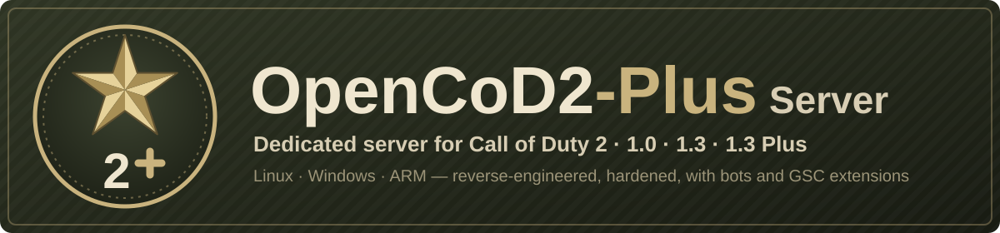

# OpenCoD2-Plus Server

<p align="center"></p>

[](https://github.com/JotaJazz/OpenCoD2-Plus-Server/actions/workflows/build.yml)
[](LICENSE)


[](https://github.com/voron00/CoD2rev_Server)
[](https://github.com/JotaJazz/OpenCoD2-Plus-Server/commits/dev)

**Español** · [English](README.md) · [Português](README.pt.md) · [Français](README.fr.md) · [Deutsch](README.de.md) · [Русский](README.ru.md)

**Tu propio servidor de Call of Duty 2, aún hoy.** OpenCoD2-Plus Server es el servidor dedicado multijugador de Call of Duty 2 reconstruido desde su código fuente, para las versiones 1.0 y 1.3, en Windows y Linux. Los jugadores entran con el juego que ya tienen; corrige muchos errores del servidor original y añade lo que les faltaba a administradores de servidores y modders. Un solo proceso de servidor puede reunir a jugadores de 1.0 y 1.3 en la misma partida.

Es un fork de [voron00/CoD2rev_Server](https://github.com/voron00/CoD2rev_Server), donde se hizo la ingeniería inversa del servidor. Hasta noviembre de 2026 se llamaba CoD2rev-Plus. También es el servidor de **CoD2 1.3 Plus**, un protocolo más nuevo para el cliente [OpenCoD2-Plus](https://github.com/JotaJazz/OpenCoD2-Plus), que todavía está en desarrollo.

## Qué hace hoy

- **Compilación para Windows y Linux:** compilación con MinGW para Windows, `make` para Linux de 64 bits, una compilación para Linux de 32 bits, una experimental para ARM de 64 bits como una Raspberry Pi, versión del juego (1.0, 1.3 o 1.3 Plus) elegida al compilar, compilaciones automáticas en cada push, lanzadores, una unidad de systemd y un `server.cfg` de ejemplo.
- **Un servidor para 1.0 y 1.3:** la compilación 1.0 juega con clientes 1.0, 1.3, de Game Pass y CoD2x, y `net_altPort` muestra la misma partida en las listas de servidores de las dos versiones.
- **Seguridad y estabilidad:** se valida la entrada de red que tumbaba el servidor o sobrescribía su memoria; las inundaciones de consultas, conexiones y comandos de cliente tienen límite; rcon bloquea las IP tras contraseñas erróneas; las descargas ya no entregan los archivos originales del juego; los baneos se revisan en cada conexión; y un fallo deja un informe en `crash.log`.
- **Compatibilidad:** cerca de un 20% menos de tráfico hacia los clientes, mensajes grandes de clientes 1.3, servidores maestros como `host:puerto`, `dedicated 1`, archivos del juego en unidades de Windows bajo WSL, un reloj de juego estable durante mucho tiempo encendido y bots que vuelven tras un cambio de mapa.
- **Administración:** contraseñas fuera del log, nombre, rotación y marcas de tiempo del log, rate y snapshots forzados, servidor de autorización de CD key configurable, mensajes de kick y timeout opcionales, opciones para el ambiente de los mapas y un apagado limpio con SIGTERM.
- **Scripting (libcod):** la mayoría de las funciones y callbacks de script de [zk_libcod](https://github.com/ibuddieat/zk_libcod), con los mismos nombres: errores de script con archivo y línea, pulsaciones de botones, comandos rcon, control de jugadores y armas, herramientas de administración, grafos de waypoints con A\*, lo que cada jugador ve, oye y con qué choca, física, JSON, SQLite, clientes HTTP y WebSocket, sonidos por el chat de voz y más, corrigiendo varios de sus errores en el camino.
- **Mod de bots:** `mods/bots`, bots que se orientan con grafos de waypoints, usan la mira, granadas y cuchillo, y juegan los objetivos de SD, CTF y HQ.
- **CoD2 1.3 Plus (en desarrollo):** `make PLUS=1` compila un servidor solo para el cliente Plus, con un handshake que les pide actualizar a los demás clientes y snapshots más pequeños, camino a 40–60 Hz. Todas las demás compilaciones mantienen el formato de red original.
- **Pruebas:** un smoke test con un cliente mínimo que lee los snapshots del servidor, una prueba de bots que juegan mapas reales y una prueba de HTTP y WebSocket.

También ejecuta las partidas locales de [OpenCoD2-Plus](https://github.com/JotaJazz/OpenCoD2-Plus), un cliente de CoD2 reconstruido. Cada cambio en detalle, con sus funciones, variables y arreglos, está en [docs/CHANGES.md](docs/CHANGES.md) (en inglés).

> [!NOTE]
> **Todavía se está mejorando.** Si algo falla o se comporta distinto que en el servidor original, repórtalo en los [issues](https://github.com/JotaJazz/OpenCoD2-Plus-Server/issues).

> [!IMPORTANT]
> **No incluye archivos del juego.** Este repositorio contiene solo código fuente. El servidor necesita la carpeta `main` con los archivos `.iwd` de una copia de Call of Duty 2 que **sea tuya**.

## Cómo ejecutarlo

Las compilaciones listas para usar están en la página de [**Releases**](https://github.com/JotaJazz/OpenCoD2-Plus-Server/releases), desde la versión candidata `v1.0.0-rc1`; también puedes compilar el servidor (ver [Compilar](#compilar)). Cópialo a la carpeta de Call of Duty 2, junto a `main`, con un `server.cfg` en `main` ([`scripts/server.cfg.example`](scripts/server.cfg.example) es un buen punto de partida).

**Windows:** copia `cod2rev_win32.exe` y [`scripts/windows/iniciar_cod2rev.bat`](scripts/windows/iniciar_cod2rev.bat), y ejecuta:

```bat
iniciar_cod2rev.bat            :: LAN o IP directa
iniciar_cod2rev.bat internet   :: también en la lista pública de servidores
```

**Linux:** copia `cod2rev_lnxded` y [`scripts/linux/iniciar_cod2rev.sh`](scripts/linux/iniciar_cod2rev.sh), y ejecuta:

```sh
./iniciar_cod2rev.sh            # LAN o IP directa
./iniciar_cod2rev.sh internet   # también en la lista pública de servidores
```

Los dos arrancan en el puerto `28960` con el mapa `mp_toujane`. Si el juego también corre en el mismo PC, arranca primero el servidor: el juego también usa el `28960`. Más opciones, la verificación de CD key y systemd están en [Ejecutar](#ejecutar). En una Raspberry Pi 3, 4 o 5 con un sistema de 64 bits, compílalo allí con `make ARCH=arm64`.

## Versiones del juego

| Compilación | Quién puede entrar | Lista de servidores |
| --- | --- | --- |
| `make` (1.0, por defecto) | Clientes 1.0, 1.3, de Game Pass y CoD2x (protocolos 115 a 119) | 1.0; con `net_altPort` también 1.3 y CoD2x |
| `make PROTOCOL=118` (1.3) | Clientes 1.3 y CoD2x (protocolo 118) | 1.3 y CoD2x |
| `make PLUS=1` (1.3 Plus) | Solo el cliente OpenCoD2-Plus; a cualquier otro cliente se le pide actualizar | 1.3, así los jugadores de la versión original ven el aviso en lugar de nada |

- **Una partida para 1.0 y 1.3:** arranca la compilación 1.0 con `+set net_altPort 28961` y responde en un segundo puerto como 1.3, con sus propios heartbeats, así que la misma partida aparece en las listas de las dos versiones. Clientes reales 1.0 y 1.3 ya jugaron juntos una partida así. Úsala con los archivos del juego 1.0, sin `iw_15.iwd`, cuyos scripts y menús no tienen los clientes 1.0.
- **CoD2x:** los clientes [CoD2x](https://github.com/callofduty2x/CoD2x) 1.4 se conectan con el protocolo 118, y su lista solo muestra los servidores que informan protocolo 118 o 120, así que ven la compilación 1.3 y el `net_altPort` de la 1.0. Un cliente CoD2x ya jugó en ambas.
- **CoD2 1.3 Plus** es para un cliente que todavía no se puede distribuir, así que un servidor Plus público tiene que esperarlo. Su protocolo está en [docs/architecture/plus-protocol.md](docs/architecture/plus-protocol.md) (en inglés).

## Para colaboradores

Toda ayuda cuenta: tener un servidor y reportar lo que falla, probar en otros sistemas, mods que usen las nuevas funciones de script, o código. El trabajo se hace en la rama `dev`, que llega a `master` con cada release. La documentación técnica, en inglés, empieza en [docs/README.md](docs/README.md); [AGENTS.md](AGENTS.md) es el punto de entrada para los agentes de programación con IA.

## Compilar

El resultado queda en `bin/` y los objetos intermedios en `obj/`.

### Linux

Por defecto el servidor es un binario de 64 bits y solo necesita `gcc` y `g++`:

```bash
make                 # 1.0 -> bin/cod2rev_lnxded
make PROTOCOL=118    # 1.3, mismo nombre
make PLUS=1          # 1.3 Plus, mismo nombre
make ARCH=x86        # 32 bits, mismo nombre
make ARCH=arm64      # ARM de 64 bits (experimental), compilado en la máquina ARM
```

La compilación de 32 bits en un sistema de 64 bits necesita el soporte de 32 bits de GCC (en Debian y Ubuntu, los paquetes `gcc-multilib` y `g++-multilib`). La compilación ARM no redondea sus cálculos como el servidor original, así que todavía no está pensada para juego competitivo.

### Windows (cruzado desde Linux con MinGW)

Necesita el compilador MinGW-w64 de 32 bits con hilos POSIX (en Debian y Ubuntu, `gcc-mingw-w64-i686-posix` y `g++-mingw-w64-i686-posix`):

```bash
make windows                 # 1.0 -> bin/cod2rev_win32.exe
make windows PROTOCOL=118    # 1.3, mismo nombre
```

<details>
<summary><b>Versión del juego, compilación automática y opciones del Makefile</b></summary>

Sin `PROTOCOL`, o con `PROTOCOL=115`, el servidor se compila como 1.0. `PLUS=1` es una compilación 1.3 y se puede combinar con `ARCH` y `windows`. Cada plataforma y versión guarda sus propios objetos en `obj/`, así que puedes cambiar de una a otra sin `make clean`; todas las versiones escriben el mismo nombre de archivo, y `BIN_DIR=<carpeta>` compila en otra carpeta para conservar varias.

Cada push a `master` o `dev` que cambie el código compila 1.0 y 1.3 para Linux (32 y 64 bits) y Windows, y 1.3 Plus para Linux de 64 bits, en GitHub Actions ([`.github/workflows/build.yml`](.github/workflows/build.yml)). Los binarios resultantes se pueden descargar como artefactos desde la pestaña [Actions](https://github.com/JotaJazz/OpenCoD2-Plus-Server/actions) del repositorio.

| Opción | Por defecto | Descripción |
| --- | --- | --- |
| `PROTOCOL` | `115` | `115` compila la 1.0, `118` la 1.3. |
| `PLUS` | `0` | `1` compila CoD2 1.3 Plus, solo para el cliente Plus. |
| `ARCH` | `x64` | `x86` para Linux de 32 bits, `arm64` para ARM de 64 bits. Windows siempre es de 32 bits. |
| `WITH_LIBCOD` | `true` | Incluye las extensiones de script de libcod (bots, jugadores, entidades, armas, utilidades, etc.). |
| `WITH_SQLITE` | `true` | Funciones de script para SQLite. |
| `WITH_MYSQL` | `false` | Funciones de script para MySQL. Requiere la biblioteca cliente de MySQL o MariaDB. |
| `WITH_SPEEX` | `true` | `loadSoundFile`, `playSoundFile` y las demás funciones de sonido, con Speex (`src/libcod/speex`). |
| `WITH_HTTP` | `true` | `httpFetch` y `webSocket*`, con Mbed TLS (`src/libcod/mbedtls`) para `https://` y `wss://`. |

`make clean` borra el binario y los objetos.

</details>

## Ejecutar

<details>
<summary><b>Lanzadores, autorización de CD key y systemd</b></summary>

Los lanzadores arrancan por defecto en modo LAN (`dedicated 1`, LAN o IP directa); con `internet` anuncian el servidor en la lista pública (`dedicated 2`). Fijan sus valores antes de `+exec server.cfg`, así que `server.cfg` puede cambiarlos. Si el juego ya corre en el mismo PC, un servidor arrancado después pasa al siguiente puerto libre; con `net_strictPort 1` se detiene en su lugar.

**Autorización de claves:** el servidor consulta `cod2master.activision.com` para validar la clave de cada cliente que no esté en la red local. Con `sv_cracked 1` sigue haciendo la consulta, pero acepta al cliente sea cual sea la respuesta. Los lanzadores solo lo activan en modo LAN; en modo internet se exige una clave válida salvo que `server.cfg` lo active.

**systemd:** `scripts/linux/cod2rev@.service` ejecuta servidores con systemd, uno por instancia: `systemctl enable --now cod2rev@public` ejecuta `public.cfg` con su propia carpeta en `/var/lib/cod2rev/public`, reinicia el servidor si se cae y lo detiene limpiamente con SIGTERM (mensaje final, heartbeat flatline y logs cerrados). Los comentarios del archivo explican cómo instalarlo.

`run_bin.sh` es el script de pruebas del proyecto original: arranca `bin/cod2rev_lnxded` en modo desarrollo con trucos activados y bots de prueba. Sirve de ejemplo de parámetros, no como configuración para un servidor real.

</details>

## Pruebas

<details>
<summary><b>Los scripts de prueba</b></summary>

`scripts/smoke_test.py` necesita un servidor compilado y una carpeta del juego:

```bash
python3 scripts/smoke_test.py /ruta/a/CoD2
make PROTOCOL=118 && python3 scripts/smoke_test.py /ruta/a/CoD2 --protocol 118
make PLUS=1 && python3 scripts/smoke_test.py /ruta/a/CoD2 --plus
```

Arranca el servidor en modo LAN con una carpeta de usuario temporal, así que la carpeta del juego solo se lee. Comprueba que el servidor carga un mapa y responde a `getinfo`, `getstatus` y rcon, y que `scripts/cod2client.py`, un cliente mínimo, puede conectarse, recibir el gamestate, entrar en la partida, leer snapshots y enviar comandos, también en un mensaje dividido en fragmentos; además prueba los ataques que el servidor debe rechazar. Usa una carpeta del juego con las `.iwd` originales: los mods en `main` que sustituyen los scripts de los modos de juego pueden impedir que cargue el mapa.

`scripts/bots_test.py` instala el mod de bots en una carpeta temporal, juega un mapa con seis bots y comprueba que el grafo de waypoints se genera, se guarda y se vuelve a leer, que los bots siguen rutas y usan la mira, las granadas y el cuchillo, y que no hay errores de script:

```bash
python3 scripts/bots_test.py /ruta/a/CoD2 --map mp_carentan
```

Con `--gametype sd`, `--gametype ctf` o `--gametype hq` comprueba en cambio que los bots jueguen el objetivo. `--bombmode 1` juega SD en modo de una sola zona de bomba. `--corrupt-cache` parte de un archivo de waypoints dañado, que los bots deben reemplazar por un grafo nuevo.

`scripts/http_test.py` comprueba `httpFetch` y `webSocket*` contra servidores locales HTTP, HTTPS, WS y WSS, y `scripts/check_docs.py` comprueba los enlaces y las rutas de la documentación.

Para buscar errores de memoria, compila el servidor con AddressSanitizer en una carpeta aparte y pásale ese binario con `--binary`:

```bash
make OBJ_ROOT=/tmp/asan/obj BIN_DIR=/tmp/asan/bin \
  CFLAGS="-fno-pie -O1 -g -fno-omit-frame-pointer -mfpmath=387 -DNDEBUG -DPROTOCOL_VERSION=115 -MMD -MP -m64 -D_FILE_OFFSET_BITS=64 -fsanitize=address" \
  LFLAGS="-no-pie -m64 -fsanitize=address"
```

`CFLAGS` en la línea de comandos reemplaza al del Makefile, así que hay que repetir `-m64` y `-D_FILE_OFFSET_BITS=64`. Dejar corriendo esa compilación un rato con el mod de bots y un `sv_mapRotation` corto cubre también los cambios de mapa y la partida.

</details>

## Estructura del repositorio

<details>
<summary><b>Qué hay en cada sitio</b></summary>

| Ruta | Contenido |
| --- | --- |
| `src/server` | Lógica del servidor: clientes, red, rcon, master servers. |
| `src/game`, `src/bgame` | Lógica de juego. |
| `src/script` | Máquina virtual de scripts GSC. |
| `src/qcommon`, `src/universal` | Código común: comandos, variables (dvars), sistema de archivos, red, el formato Plus. |
| `src/xanim` | Modelos y animaciones. |
| `src/stringed` | Textos localizados. |
| `src/libcod` | Extensiones de script de libcod, con las bibliotecas que usan: SQLite, yyjson, Speex, Mbed TLS y las cabeceras de MySQL. |
| `src/win32`, `src/unix` | Código específico de cada plataforma. |
| `src/zlib` | Copia de zlib. |
| `docs` | Documentación técnica para colaboradores y agentes de IA (índice en [docs/README.md](docs/README.md)), la lista de cambios y el protocolo de CoD2 1.3 Plus. |
| `scripts` | Lanzadores para Windows y Linux, la unidad de systemd, el `server.cfg` de ejemplo y su generador, el instalador de los bots, la prueba de humo con su cliente mínimo, la prueba de los bots, la prueba de HTTP y WebSocket, y el verificador de la documentación. |
| `mods/bots` | El mod de scripts de los bots. |

</details>

## Transparencia

- **Quién mantiene esto:** soy JotaJazz. Me gustan los juegos antiguos y este fork existe por eso: quiero seguir pudiendo levantar un servidor de CoD2 en mis propias máquinas.
- **Cómo se trabaja aquí:** trabajo con [Claude Code](https://claude.com/claude-code), el asistente de programación de Anthropic. Los cambios de este fork, incluidos este README y sus traducciones, están escritos con su ayuda. Los commits hechos así llevan la línea `Co-Authored-By: Claude` en el mensaje, de modo que se pueden identificar en el historial con `git log`.
- **Relación con el original:** este fork trae cambios del repositorio original cuando los hay, pero no le envía los suyos. Es probable que con el tiempo se aleje de él.
- **Qué no es:** no es un proyecto oficial ni está afiliado a Activision, Infinity Ward ni al autor del repositorio original. No incluye ningún archivo del juego.

## Aviso

Esta es una reconstrucción independiente, a nivel de código fuente, del servidor dedicado de Call of Duty 2. No está afiliada a Activision Publishing, Inc., Infinity Ward ni a ninguna de sus filiales, ni autorizada, patrocinada o respaldada por ellas.

"Call of Duty" y "Call of Duty 2" son marcas registradas de Activision Publishing, Inc. En este repositorio se usan solo con fines de identificación e interoperabilidad, para describir lo que reconstruye el código. No se reclama ningún derecho sobre esas marcas.

Este proyecto no proporciona datos del juego protegidos por derechos de autor ni ayuda a obtenerlos. Para usarlo con el contenido real del juego, debes aportar los archivos de datos de una copia de Call of Duty 2 que poseas legalmente.

Si eres titular de derechos y crees que algo de lo que hay aquí no debería distribuirse, abre un issue o contacta con el mantenedor y se atenderá cuanto antes.

## Licencia

[GNU Affero General Public License v3.0](LICENSE), la misma que el proyecto original. Las bibliotecas incluidas conservan sus propias licencias: SQLite (dominio público), Mbed TLS (Apache-2.0, `src/libcod/mbedtls/LICENSE`), yyjson (MIT), Speex (BSD, `src/libcod/speex/COPYING`) y zlib (licencia zlib).

## Créditos

- [voron00](https://github.com/voron00/CoD2rev_Server), autor del proyecto original
- id Software
- Activision / Infinity Ward
- [CoD4x Server](https://github.com/callofduty4x/CoD4x_Server)
- [OpenBO2](https://github.com/builtbyxeno/OpenBO2)
- [zk_libcod](https://github.com/ibuddieat/zk_libcod) (ibuddieat), donde se encontraron varios de los arreglos de este fork
