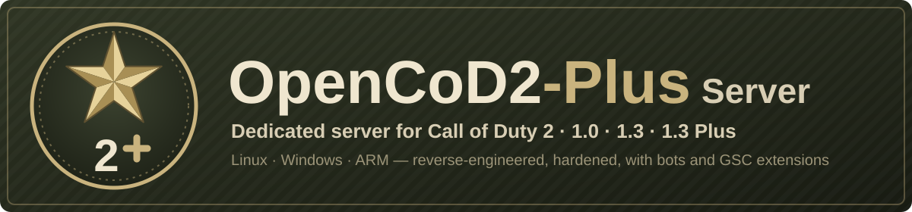

# OpenCoD2-Plus Server

<p align="center"></p>

[](https://github.com/JotaJazz/OpenCoD2-Plus-Server/actions/workflows/build.yml)
[](LICENSE)


[](https://github.com/voron00/CoD2rev_Server)
[](https://github.com/JotaJazz/OpenCoD2-Plus-Server/commits/dev)

[Español](README.es.md) · [English](README.md) · [Português](README.pt.md) · **Français** · [Deutsch](README.de.md) · [Русский](README.ru.md)

**Votre propre serveur Call of Duty 2, encore aujourd'hui.** OpenCoD2-Plus Server est le serveur dédié multijoueur de Call of Duty 2 reconstruit à partir de son code source, pour les versions 1.0 et 1.3, sous Windows et Linux. Les joueurs s'y connectent avec le jeu qu'ils ont déjà ; il corrige de nombreux bogues du serveur d'origine et ajoute ce qui manquait aux administrateurs de serveurs et aux moddeurs. Un seul processus serveur peut accueillir des joueurs 1.0 et 1.3 dans la même partie.

C'est un fork de [voron00/CoD2rev_Server](https://github.com/voron00/CoD2rev_Server), où la rétro-ingénierie du serveur a été réalisée. Jusqu'en novembre 2026, il s'appelait CoD2rev-Plus. C'est aussi le serveur de **CoD2 1.3 Plus**, un protocole plus récent pour le client [OpenCoD2-Plus](https://github.com/JotaJazz/OpenCoD2-Plus), encore en développement.

## Ce qu'il fait aujourd'hui

- **Compilation pour Windows et Linux :** compilation MinGW pour Windows, `make` pour Linux 64 bits, une compilation Linux 32 bits, une compilation expérimentale pour ARM 64 bits comme un Raspberry Pi, version du jeu (1.0, 1.3 ou 1.3 Plus) choisie à la compilation, compilations automatiques à chaque push, lanceurs, une unité systemd et un `server.cfg` d'exemple.
- **Un seul serveur pour 1.0 et 1.3 :** la compilation 1.0 joue avec les clients 1.0, 1.3, Game Pass et CoD2x, et `net_altPort` affiche la même partie dans les listes de serveurs des deux versions.
- **Sécurité et stabilité :** les entrées réseau qui faisaient planter le serveur ou écrasaient sa mémoire sont maintenant vérifiées ; les rafales de requêtes, de connexions et de commandes client sont limitées ; rcon bloque les IP après des mots de passe erronés ; les téléchargements ne livrent plus les fichiers d'origine du jeu ; les bannissements sont vérifiés à chaque connexion ; et un plantage laisse un rapport dans `crash.log`.
- **Compatibilité :** environ 20 % de trafic en moins vers les clients, grands messages des clients 1.3, serveurs maîtres en `hôte:port`, `dedicated 1`, fichiers du jeu sur des lecteurs Windows sous WSL, une horloge de jeu stable sur de longues durées de fonctionnement et des bots qui reviennent après un changement de carte.
- **Administration :** mots de passe absents du log, nom, rotation et horodatage du log, rate et snapshots imposés, serveur d'autorisation de clé CD configurable, messages de kick et de timeout optionnels, des réglages de l'ambiance des cartes et un arrêt propre sur SIGTERM.
- **Scripts (libcod) :** la plupart des fonctions et callbacks de script de [zk_libcod](https://github.com/ibuddieat/zk_libcod), sous les mêmes noms : erreurs de script avec fichier et ligne, appuis sur les boutons, commandes rcon, contrôle des joueurs et des armes, outils d'administration, graphes de waypoints avec A\*, ce que chaque joueur voit, entend et ce qu'il percute, la physique, JSON, SQLite, des clients HTTP et WebSocket, des sons par le chat vocal et plus, en corrigeant plusieurs de ses bugs au passage.
- **Mod de bots :** `mods/bots`, des bots qui se repèrent avec des graphes de waypoints, utilisent la visée, les grenades et le couteau, et jouent les objectifs de SD, de CTF et de HQ.
- **CoD2 1.3 Plus (en développement) :** `make PLUS=1` compile un serveur réservé au client Plus, avec une négociation de connexion qui demande aux autres clients de se mettre à jour et des snapshots plus petits, en route vers 40–60 Hz. Toutes les autres compilations gardent le format réseau d'origine.
- **Tests :** un smoke test avec un client minimal qui lit les snapshots du serveur, un test de bots qui joue de vraies cartes, et un test HTTP et WebSocket.

Il fait aussi tourner les parties locales d'[OpenCoD2-Plus](https://github.com/JotaJazz/OpenCoD2-Plus), un client CoD2 reconstruit. Chaque changement en détail, avec ses fonctions, variables et corrections, se trouve dans [docs/CHANGES.md](docs/CHANGES.md) (en anglais).

> [!NOTE]
> **Toujours en cours d'amélioration.** Si quelque chose ne fonctionne pas ou se comporte différemment du serveur d'origine, merci de le signaler dans les [issues](https://github.com/JotaJazz/OpenCoD2-Plus-Server/issues).

> [!IMPORTANT]
> **Aucun fichier du jeu n'est inclus.** Ce dépôt ne contient que du code source. Le serveur a besoin du dossier `main` avec les fichiers `.iwd` d'une copie de Call of Duty 2 que **vous possédez**.

## Comment le lancer

Des versions prêtes à l'emploi sont disponibles sur la page [**Releases**](https://github.com/JotaJazz/OpenCoD2-Plus-Server/releases), à partir de la version candidate `v1.0.0-rc1` ; vous pouvez aussi compiler le serveur (voir [Compilation](#compilation)). Copiez-le dans votre dossier de Call of Duty 2, à côté de `main`, avec un `server.cfg` dans `main` ([`scripts/server.cfg.example`](scripts/server.cfg.example) est un bon point de départ).

**Windows :** copiez `cod2rev_win32.exe` et [`scripts/windows/iniciar_cod2rev.bat`](scripts/windows/iniciar_cod2rev.bat), puis lancez :

```bat
iniciar_cod2rev.bat            :: réseau local ou IP directe
iniciar_cod2rev.bat internet   :: aussi dans la liste publique des serveurs
```

**Linux :** copiez `cod2rev_lnxded` et [`scripts/linux/iniciar_cod2rev.sh`](scripts/linux/iniciar_cod2rev.sh), puis lancez :

```sh
./iniciar_cod2rev.sh            # réseau local ou IP directe
./iniciar_cod2rev.sh internet   # aussi dans la liste publique des serveurs
```

Les deux démarrent sur le port `28960` avec la carte `mp_toujane`. Si le jeu tourne aussi sur ce PC, démarrez d'abord le serveur : le jeu utilise aussi le `28960`. D'autres options, la vérification des clés CD et systemd sont décrites dans [Exécution](#exécution). Sur un Raspberry Pi 3, 4 ou 5 avec un système 64 bits, compilez-le sur place avec `make ARCH=arm64`.

## Versions du jeu

| Compilation | Qui peut se connecter | Liste de serveurs |
| --- | --- | --- |
| `make` (1.0, par défaut) | Clients 1.0, 1.3, Game Pass et CoD2x (protocoles 115 à 119) | 1.0 ; avec `net_altPort`, aussi 1.3 et CoD2x |
| `make PROTOCOL=118` (1.3) | Clients 1.3 et CoD2x (protocole 118) | 1.3 et CoD2x |
| `make PLUS=1` (1.3 Plus) | Seulement le client OpenCoD2-Plus ; tout autre client est invité à se mettre à jour | 1.3, pour que les joueurs d'origine voient l'avis au lieu de rien |

- **Une partie pour 1.0 et 1.3 :** démarrez la compilation 1.0 avec `+set net_altPort 28961` et elle répond sur un second port en 1.3, avec ses propres heartbeats, de sorte que la même partie apparaît pour les deux versions. De vrais clients 1.0 et 1.3 ont joué ensemble une même partie de cette façon. Lancez-la sur les fichiers du jeu 1.0, sans `iw_15.iwd`, dont les scripts et les menus manquent aux clients 1.0.
- **CoD2x :** les clients [CoD2x](https://github.com/callofduty2x/CoD2x) 1.4 se connectent avec le protocole 118, et leur liste de serveurs n'affiche que ceux qui annoncent le protocole 118 ou 120 ; ils voient donc la compilation 1.3 et le `net_altPort` de la compilation 1.0. Un client CoD2x a joué sur les deux.
- **CoD2 1.3 Plus** est destiné à un client qui ne peut pas encore être distribué ; un serveur Plus public doit donc l'attendre. Son protocole est décrit dans [docs/architecture/plus-protocol.md](docs/architecture/plus-protocol.md) (en anglais).

## Pour les contributeurs

Toute aide compte : faire tourner un serveur et signaler ce qui ne va pas, tester sur d'autres systèmes, des mods qui utilisent les nouvelles fonctions de script, ou du code. Le travail se fait sur la branche `dev`, qui rejoint `master` à chaque version publiée. La documentation technique, en anglais, commence dans [docs/README.md](docs/README.md) ; [AGENTS.md](AGENTS.md) est le point d'entrée pour les agents de programmation d'IA.

## Compilation

Le résultat est placé dans `bin/` et les objets intermédiaires dans `obj/`.

### Linux

Par défaut, le serveur est un binaire 64 bits et ne demande que `gcc` et `g++` :

```bash
make                 # 1.0 -> bin/cod2rev_lnxded
make PROTOCOL=118    # 1.3, même nom
make PLUS=1          # 1.3 Plus, même nom
make ARCH=x86        # 32 bits, même nom
make ARCH=arm64      # ARM 64 bits (expérimental), compilé sur la machine ARM
```

La compilation 32 bits sur un système 64 bits demande la prise en charge 32 bits de GCC (sous Debian et Ubuntu, les paquets `gcc-multilib` et `g++-multilib`). La compilation ARM n'arrondit pas ses calculs comme le serveur d'origine, elle n'est donc pas encore destinée au jeu compétitif.

### Windows (compilation croisée depuis Linux avec MinGW)

Nécessite le compilateur MinGW-w64 32 bits avec les threads POSIX (sous Debian et Ubuntu, `gcc-mingw-w64-i686-posix` et `g++-mingw-w64-i686-posix`) :

```bash
make windows                 # 1.0 -> bin/cod2rev_win32.exe
make windows PROTOCOL=118    # 1.3, même nom
```

<details>
<summary><b>Version du jeu, compilations automatiques et options du Makefile</b></summary>

Sans `PROTOCOL`, ou avec `PROTOCOL=115`, le serveur est compilé en 1.0. `PLUS=1` est une compilation 1.3 et peut se combiner avec `ARCH` et `windows`. Chaque plateforme et chaque version garde ses propres objets dans `obj/`, vous pouvez donc passer de l'une à l'autre sans `make clean` ; toutes les versions écrivent le même nom de fichier, et `BIN_DIR=<dossier>` compile dans un autre dossier pour en garder plusieurs.

Chaque push sur `master` ou `dev` qui modifie le code compile la 1.0 et la 1.3 pour Linux (32 et 64 bits) et Windows, et la 1.3 Plus pour Linux 64 bits, dans GitHub Actions ([`.github/workflows/build.yml`](.github/workflows/build.yml)). Les binaires obtenus peuvent être téléchargés comme artefacts depuis l'onglet [Actions](https://github.com/JotaJazz/OpenCoD2-Plus-Server/actions) du dépôt.

| Option | Valeur par défaut | Description |
| --- | --- | --- |
| `PROTOCOL` | `115` | `115` compile la 1.0, `118` compile la 1.3. |
| `PLUS` | `0` | `1` compile CoD2 1.3 Plus, réservé au client Plus. |
| `ARCH` | `x64` | `x86` pour Linux 32 bits, `arm64` pour ARM 64 bits. Windows est toujours en 32 bits. |
| `WITH_LIBCOD` | `true` | Inclut les extensions de script de libcod (bots, joueurs, entités, armes, utilitaires, etc.). |
| `WITH_SQLITE` | `true` | Fonctions de script pour SQLite. |
| `WITH_MYSQL` | `false` | Fonctions de script pour MySQL. Nécessite la bibliothèque cliente MySQL ou MariaDB. |
| `WITH_SPEEX` | `true` | `loadSoundFile`, `playSoundFile` et les autres fonctions de son, avec Speex (`src/libcod/speex`). |
| `WITH_HTTP` | `true` | `httpFetch` et `webSocket*`, avec Mbed TLS (`src/libcod/mbedtls`) pour `https://` et `wss://`. |

`make clean` supprime le binaire et les objets.

</details>

## Exécution

<details>
<summary><b>Lanceurs, autorisation des clés CD et systemd</b></summary>

Les lanceurs démarrent par défaut en mode réseau local (`dedicated 1` : réseau local ou IP directe) ; avec `internet`, ils annoncent le serveur dans la liste publique (`dedicated 2`). Ils fixent leurs valeurs avant `+exec server.cfg`, donc `server.cfg` peut les changer. Si le jeu tourne déjà sur ce PC, un serveur démarré après lui passe au port libre suivant ; `net_strictPort 1` le fait s'arrêter à la place.

**Autorisation des clés :** le serveur interroge `cod2master.activision.com` pour valider la clé de chaque client qui n'est pas sur le réseau local. Avec `sv_cracked 1`, il envoie toujours la requête, mais accepte le client quelle que soit la réponse. Les lanceurs ne l'activent qu'en mode réseau local ; en mode internet, une clé valide est exigée sauf si `server.cfg` l'active.

**systemd :** `scripts/linux/cod2rev@.service` lance des serveurs avec systemd, un par instance : `systemctl enable --now cod2rev@public` exécute `public.cfg` avec son propre dossier dans `/var/lib/cod2rev/public`, redémarre le serveur s'il plante et l'arrête proprement avec SIGTERM (message final, heartbeat flatline et logs fermés). Les commentaires du fichier expliquent comment l'installer.

`run_bin.sh` est le script de test du projet d'origine : il démarre `bin/cod2rev_lnxded` en mode développeur avec les triches activées et des bots de test. Il sert d'exemple de paramètres, pas de configuration pour un vrai serveur.

</details>

## Tests

<details>
<summary><b>Les scripts de test</b></summary>

`scripts/smoke_test.py` a besoin d'un serveur compilé et d'un dossier du jeu :

```bash
python3 scripts/smoke_test.py /chemin/vers/CoD2
make PROTOCOL=118 && python3 scripts/smoke_test.py /chemin/vers/CoD2 --protocol 118
make PLUS=1 && python3 scripts/smoke_test.py /chemin/vers/CoD2 --plus
```

Il démarre le serveur en mode LAN avec un dossier utilisateur temporaire, le dossier du jeu n'est donc que lu. Il vérifie que le serveur charge une carte et répond à `getinfo`, `getstatus` et rcon, et que `scripts/cod2client.py`, un client minimal, peut se connecter, recevoir le gamestate, entrer dans la partie, lire les snapshots et envoyer des commandes, y compris dans un message découpé en fragments ; il essaie aussi les attaques que le serveur doit refuser. Utilisez un dossier du jeu avec les `.iwd` d'origine : des mods dans `main` qui remplacent les scripts des modes de jeu peuvent empêcher la carte de se charger.

`scripts/bots_test.py` installe le mod de bots dans un dossier temporaire, joue une carte avec six bots et vérifie que le graphe de waypoints est généré, enregistré puis relu, que les bots suivent des chemins et utilisent la mire, les grenades et le couteau, et qu'aucune erreur de script ne se produit :

```bash
python3 scripts/bots_test.py /chemin/vers/CoD2 --map mp_carentan
```

Avec `--gametype sd`, `--gametype ctf` ou `--gametype hq`, il vérifie plutôt que les bots jouent l'objectif. `--bombmode 1` joue en SD avec une seule zone de bombe. `--corrupt-cache` part d'un fichier de waypoints endommagé, que les bots doivent remplacer par un nouveau graphe.

`scripts/http_test.py` vérifie `httpFetch` et `webSocket*` contre des serveurs HTTP, HTTPS, WS et WSS locaux, et `scripts/check_docs.py` vérifie les liens et les chemins de la documentation.

Pour chercher des erreurs mémoire, compilez le serveur avec AddressSanitizer dans un dossier séparé et passez ce binaire avec `--binary` :

```bash
make OBJ_ROOT=/tmp/asan/obj BIN_DIR=/tmp/asan/bin \
  CFLAGS="-fno-pie -O1 -g -fno-omit-frame-pointer -mfpmath=387 -DNDEBUG -DPROTOCOL_VERSION=115 -MMD -MP -m64 -D_FILE_OFFSET_BITS=64 -fsanitize=address" \
  LFLAGS="-no-pie -m64 -fsanitize=address"
```

`CFLAGS` donné en ligne de commande remplace celui du Makefile, il faut donc répéter `-m64` et `-D_FILE_OFFSET_BITS=64`. Laisser tourner cette compilation un moment avec le mod de bots et un `sv_mapRotation` court couvre aussi les changements de carte et le jeu.

</details>

## Structure du dépôt

<details>
<summary><b>Ce qui se trouve où</b></summary>

| Chemin | Contenu |
| --- | --- |
| `src/server` | Logique du serveur : clients, réseau, rcon, serveurs maîtres. |
| `src/game`, `src/bgame` | Logique de jeu. |
| `src/script` | Machine virtuelle des scripts GSC. |
| `src/qcommon`, `src/universal` | Code commun : commandes, variables (dvars), système de fichiers, réseau, le format Plus. |
| `src/xanim` | Modèles et animations. |
| `src/stringed` | Textes localisés. |
| `src/libcod` | Extensions de script de libcod, avec les bibliothèques qu'elles utilisent : SQLite, yyjson, Speex, Mbed TLS et les en-têtes MySQL. |
| `src/win32`, `src/unix` | Code propre à chaque plateforme. |
| `src/zlib` | Copie de zlib. |
| `docs` | Documentation technique pour les contributeurs et les agents d'IA (index dans [docs/README.md](docs/README.md)), la liste des changements et le protocole CoD2 1.3 Plus. |
| `scripts` | Lanceurs pour Windows et Linux, l'unité systemd, le `server.cfg` d'exemple et son générateur, l'installateur des bots, le test de bon fonctionnement avec son client minimal, le test des bots, le test HTTP et WebSocket, et le vérificateur de la documentation. |
| `mods/bots` | Le mod de scripts des bots. |

</details>

## Transparence

- **Qui maintient ce dépôt :** je suis JotaJazz. J'aime les vieux jeux, et c'est la raison d'être de ce fork : je veux pouvoir continuer à faire tourner un serveur CoD2 sur mes propres machines.
- **Comment le travail est fait :** je travaille avec [Claude Code](https://claude.com/claude-code), l'assistant de programmation d'Anthropic. Les modifications de ce fork, y compris ce README et ses traductions, sont écrites avec son aide. Les commits réalisés ainsi portent la ligne `Co-Authored-By: Claude` dans leur message, ce qui permet de les identifier dans l'historique avec `git log`.
- **Relation avec l'original :** ce fork récupère les modifications du dépôt d'origine quand il y en a, mais ne lui envoie pas les siennes. Il s'en éloignera probablement avec le temps.
- **Ce que ce n'est pas :** ce n'est pas un projet officiel et il n'est affilié ni à Activision, ni à Infinity Ward, ni à l'auteur du dépôt d'origine. Il ne contient aucun fichier du jeu.

## Avis

Ce projet est une reconstruction indépendante, au niveau du code source, du serveur dédié de Call of Duty 2. Il n'est ni affilié à Activision Publishing, Inc., à Infinity Ward ou à l'une de leurs filiales, ni autorisé, parrainé ou approuvé par eux.

« Call of Duty » et « Call of Duty 2 » sont des marques d'Activision Publishing, Inc. Elles ne sont utilisées dans ce dépôt qu'à des fins d'identification et d'interopérabilité, pour décrire ce que le code reconstruit. Aucun droit n'est revendiqué sur ces marques.

Ce projet ne fournit pas de données de jeu protégées par le droit d'auteur et n'aide pas à en obtenir. Pour l'utiliser avec le vrai contenu du jeu, vous devez fournir les fichiers de données d'une copie de Call of Duty 2 que vous possédez légalement.

Si vous êtes titulaire de droits et pensez que quelque chose ici ne devrait pas être distribué, merci d'ouvrir une issue ou de contacter le mainteneur ; ce sera traité rapidement.

## Licence

[GNU Affero General Public License v3.0](LICENSE), la même que celle du projet d'origine. Les bibliothèques incluses gardent leurs propres licences : SQLite (domaine public), Mbed TLS (Apache-2.0, `src/libcod/mbedtls/LICENSE`), yyjson (MIT), Speex (BSD, `src/libcod/speex/COPYING`) et zlib (licence zlib).

## Crédits

- [voron00](https://github.com/voron00/CoD2rev_Server), auteur du projet d'origine
- id Software
- Activision / Infinity Ward
- [CoD4x Server](https://github.com/callofduty4x/CoD4x_Server)
- [OpenBO2](https://github.com/builtbyxeno/OpenBO2)
- [zk_libcod](https://github.com/ibuddieat/zk_libcod) (ibuddieat), où plusieurs des correctifs de ce fork ont été trouvés
