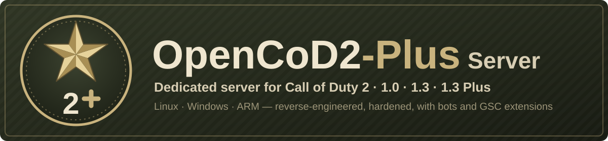

# OpenCoD2-Plus Server

<p align="center"></p>

[](https://github.com/JotaJazz/OpenCoD2-Plus-Server/actions/workflows/build.yml)
[](LICENSE)


[](https://github.com/voron00/CoD2rev_Server)
[](https://github.com/JotaJazz/OpenCoD2-Plus-Server/commits/dev)

[Español](README.es.md) · **English** · [Português](README.pt.md) · [Français](README.fr.md) · [Deutsch](README.de.md) · [Русский](README.ru.md)

**Your own Call of Duty 2 server, still.** OpenCoD2-Plus Server is the Call of Duty 2 multiplayer dedicated server rebuilt from its source, for versions 1.0 and 1.3, on Windows and Linux. Players join it with the game they already have; it fixes many bugs of the original server and adds what server admins and modders have been missing. One server process can host 1.0 and 1.3 players in the same match.

It is a fork of [voron00/CoD2rev_Server](https://github.com/voron00/CoD2rev_Server), where the reverse-engineering of the server was done. Until November 2026 it was called CoD2rev-Plus. It is also the server of **CoD2 1.3 Plus**, a newer protocol for the [OpenCoD2-Plus](https://github.com/JotaJazz/OpenCoD2-Plus) client, which is still in development.

## What it does today

- **Builds for Windows and Linux:** a MinGW build for Windows, `make` for 64-bit Linux, a 32-bit Linux build, an experimental build for 64-bit ARM such as a Raspberry Pi, the game version (1.0, 1.3 or 1.3 Plus) chosen at build time, automated builds on every push, launchers, a systemd unit and an example `server.cfg`.
- **One server for 1.0 and 1.3:** the 1.0 build plays with 1.0, 1.3, Game Pass and CoD2x clients, and `net_altPort` lists the same match in the server browsers of both versions.
- **Security and stability:** network input that crashed the server or overwrote its memory is now bounds-checked; floods of queries, connects and client commands are rate-limited; rcon locks out IPs after wrong passwords; downloads can't fetch the stock game files; bans are checked on every connect; and a crash leaves a report in `crash.log`.
- **Compatibility:** about 20% less traffic to clients, large messages from 1.3 clients, master servers given as `host:port`, `dedicated 1`, game files on Windows drives under WSL, a steady game clock over long uptimes, and bots that come back after a map change.
- **Administration:** passwords kept out of the log, log naming, rotation and timestamps, a forced rate and snapshot rate, a configurable CD key authorization server, optional kick and timeout messages, map ambience switches and a clean shutdown on SIGTERM.
- **Scripting (libcod):** most of [zk_libcod](https://github.com/ibuddieat/zk_libcod)'s script functions and callbacks, with the same names: script errors with file and line, button presses, rcon commands, player and weapon control, admin tools, waypoint graphs with A\*, what each player sees, hears and collides with, physics, JSON, SQLite, HTTP and WebSocket clients, sounds through voice chat and more, fixing several of its bugs on the way.
- **Bots mod:** `mods/bots`, bots that find their way over waypoint graphs, use sights, grenades and knives, and play the SD, CTF and HQ objectives.
- **CoD2 1.3 Plus (in development):** `make PLUS=1` builds a server only for the Plus client, with a handshake that tells other clients to update and smaller snapshots, on the way to 40–60 Hz. Every other build keeps the original network format. See [what Plus adds](#cod2-13-plus-what-it-adds).
- **Tests:** a smoke test with a minimal client that reads the server's snapshots, a bots test that plays real maps, and an HTTP and WebSocket test.

It also runs the local games of [OpenCoD2-Plus](https://github.com/JotaJazz/OpenCoD2-Plus), a rebuilt CoD2 client. Every change in detail, with its functions, variables and fixes, is in [docs/CHANGES.md](docs/CHANGES.md).

> [!NOTE]
> **Still being improved.** If something breaks or behaves differently from the original server, please report it in the [issues](https://github.com/JotaJazz/OpenCoD2-Plus-Server/issues).

> [!IMPORTANT]
> **No game files are included.** This repository is source code only. The server needs the `main` folder with the `.iwd` files from a copy of Call of Duty 2 that **you own**.

## CoD2 1.3 Plus: what it adds

A server built with `make PLUS=1` plays only with the [OpenCoD2-Plus](https://github.com/JotaJazz/OpenCoD2-Plus) client, and in exchange it can change what the original game never could: the tick rate, the network format and rules the client predicts. Every other build stays the original server.

| | What changes | Why it matters |
| --- | --- | --- |
| **20, 40 and 60 Hz** | `sv_fps` alone sets the rate: every Plus client gets a snapshot each frame and the bandwidth for it. Turrets, `trigger_hurt`, script `wait`, the killcam and the antilag keep their timing at any rate. | Smoother aim and movement, with no client settings to get right and no mod that runs faster at 60 Hz. |
| **Antilag that rewinds the whole player** | A shot is checked against where the target was when you fired: its position, and also its lean, yaw, aim, stance and the animation of crouching or going prone. | "I hit him and it didn't count" goes away for players who leaned out or ducked a moment ago. |
| **Fixes the client predicts** | Fast reload, prone peek, MG clip and the climbing sound, fixed in the game itself instead of in mod scripts that fight the client. | The same rules for everyone, without `zPAM` workarounds. Mods detect them with `getCvarInt("sv_plus") >= 123`. |
| **Smaller snapshots** | Entity times travel as a short offset. | About 12% less traffic per client. |
| **Downloads from the server itself** | On a Linux server with `sv_wwwBaseURL auto`, a Plus client that lacks a mod downloads it over HTTP from the game port. Only the redirected player can fetch only that file, at a capped rate. | No web server to set up and nothing to upload: open the game port to TCP too, and the mod downloads at full speed. Other clients keep the URL you give them. |
| **Fairer votes** | A player who leaves and joins again keeps the vote they cast and the votes they called. | Nobody votes twice in the same vote. |
| **A clear message for everyone else** | A stock 1.3 or CoD2x player who tries to join is told to get the Plus client, with a link (`sv_plusNotice`). The server still shows up in every browser as 1.3. | Nobody is left wondering why they cannot connect. |

A 60 Hz Plus server with its own downloads needs only this in its `server.cfg`:

```cfg
set sv_fps 60
set sv_wwwDownload 1
set sv_wwwBaseURL auto
```

The protocol, its measurements and the server's side of each rule are in [docs/architecture/plus-protocol.md](docs/architecture/plus-protocol.md).

## How to run

Ready-to-run builds are on the [**Releases**](https://github.com/JotaJazz/OpenCoD2-Plus-Server/releases) page, starting with the release candidate `v1.0.0-rc1`; you can also build the server yourself (see [Building](#building)). Copy it into your Call of Duty 2 folder, next to `main`, with a `server.cfg` in `main` ([`scripts/server.cfg.example`](scripts/server.cfg.example) is a good start).

**Windows:** copy `cod2rev_win32.exe` and [`scripts/windows/iniciar_cod2rev.bat`](scripts/windows/iniciar_cod2rev.bat), then run:

```bat
iniciar_cod2rev.bat            :: LAN or direct IP
iniciar_cod2rev.bat internet   :: also on the public server list
```

**Linux:** copy `cod2rev_lnxded` and [`scripts/linux/iniciar_cod2rev.sh`](scripts/linux/iniciar_cod2rev.sh), then run:

```sh
./iniciar_cod2rev.sh            # LAN or direct IP
./iniciar_cod2rev.sh internet   # also on the public server list
```

Both start on port `28960` with the map `mp_toujane`. If the game also runs on the same PC, start the server first: the game uses `28960` too. More options, CD key checks and systemd are in [Running](#running). On a Raspberry Pi 3, 4 or 5 with a 64-bit system, build it there with `make ARCH=arm64`.

## Game versions

| Build | Who can join | Server browser |
| --- | --- | --- |
| `make` (1.0, the default) | 1.0, 1.3, Game Pass and CoD2x clients (protocols 115 to 119) | 1.0; with `net_altPort` also 1.3 and CoD2x |
| `make PROTOCOL=118` (1.3) | 1.3 and CoD2x clients (protocol 118) | 1.3 and CoD2x |
| `make PLUS=1` (1.3 Plus) | Only the OpenCoD2-Plus client; any other client is told to update | 1.3, so stock players see the notice instead of nothing |

- **One match for 1.0 and 1.3:** start the 1.0 build with `+set net_altPort 28961` and it answers on a second port as 1.3, with its own heartbeats, so the same match is listed for both versions. Real 1.0 and 1.3 clients have played one match together this way. Run it on the 1.0 game files, without `iw_15.iwd`, whose scripts and menus 1.0 clients lack.
- **CoD2x:** [CoD2x](https://github.com/callofduty2x/CoD2x) 1.4 clients connect with protocol 118, and their browser only lists servers that report protocol 118 or 120, so they see the 1.3 build and the `net_altPort` of the 1.0 build. A CoD2x client has played on both.
- **CoD2 1.3 Plus** is for a client that cannot be distributed yet, so a public Plus server has to wait for it. Its protocol is in [docs/architecture/plus-protocol.md](docs/architecture/plus-protocol.md).

## For contributors

Every kind of help counts: running a server and reporting what goes wrong, testing on other systems, mods that use the new script functions, or code. Work happens on the `dev` branch, which reaches `master` with each release. The technical documentation, in English, starts at [docs/README.md](docs/README.md); [AGENTS.md](AGENTS.md) is the entry point for AI coding agents.

## Building

The output goes to `bin/` and intermediate objects to `obj/`.

### Linux

The server is a 64-bit binary by default and needs only `gcc` and `g++`:

```bash
make                 # 1.0 -> bin/cod2rev_lnxded
make PROTOCOL=118    # 1.3, same name
make PLUS=1          # 1.3 Plus, same name
make ARCH=x86        # 32-bit, same name
make ARCH=arm64      # 64-bit ARM (experimental), built on the ARM machine
```

The 32-bit build on a 64-bit system needs GCC's 32-bit support (on Debian and Ubuntu, the `gcc-multilib` and `g++-multilib` packages).

### Windows (cross-compiled from Linux with MinGW)

Requires the 32-bit MinGW-w64 compiler with POSIX threads (on Debian and Ubuntu, `gcc-mingw-w64-i686-posix` and `g++-mingw-w64-i686-posix`):

```bash
make windows                 # 1.0 -> bin/cod2rev_win32.exe
make windows PROTOCOL=118    # 1.3, same name
```

### Windows (on Windows itself, with MSYS2)

Install [MSYS2](https://www.msys2.org/) and, from its shell, its 32-bit MinGW-w64 compiler: `pacman -S mingw-w64-i686-gcc mingw-w64-i686-make`. Then build from `cmd`, not from the MSYS2 shell, with only that compiler and Windows in `PATH`:

```bat
set PATH=%SystemDrive%\msys64\mingw32\bin;%SystemRoot%\system32;%SystemRoot%
mingw32-make                 :: 1.0 -> bin\cod2rev_win32.exe
mingw32-make PROTOCOL=118    :: 1.3, same name
```

<details>
<summary><b>Game version, automated builds and Makefile options</b></summary>

Without `PROTOCOL`, or with `PROTOCOL=115`, the server is built as 1.0. `PLUS=1` is a 1.3 build and can be combined with `ARCH` and `windows`. Each platform and version keeps its own objects under `obj/`, so you can switch between them without `make clean`; every version writes the same file name, and `BIN_DIR=<folder>` builds into another folder to keep several.

Every push to `master` or `dev` that changes the code builds 1.0 and 1.3 for Linux (32 and 64-bit) and Windows, and 1.3 Plus for 64-bit Linux, on GitHub Actions ([`.github/workflows/build.yml`](.github/workflows/build.yml)). The resulting binaries can be downloaded as artifacts from the repository's [Actions](https://github.com/JotaJazz/OpenCoD2-Plus-Server/actions) tab.

| Option | Default | Description |
| --- | --- | --- |
| `PROTOCOL` | `115` | `115` builds 1.0, `118` builds 1.3. |
| `PLUS` | `0` | `1` builds CoD2 1.3 Plus, only for the Plus client. |
| `ARCH` | `x64` | `x86` for 32-bit Linux, `arm64` for 64-bit ARM. Windows is always 32-bit. |
| `WITH_LIBCOD` | `true` | Includes the libcod script extensions (bots, players, entities, weapons, utilities, etc.). |
| `WITH_SQLITE` | `true` | Script functions for SQLite. |
| `WITH_MYSQL` | `false` | Script functions for MySQL. Requires the MySQL or MariaDB client library. |
| `WITH_SPEEX` | `true` | `loadSoundFile`, `playSoundFile` and the other sound functions, with Speex (`src/libcod/speex`). |
| `WITH_HTTP` | `true` | `httpFetch` and `webSocket*`, with Mbed TLS (`src/libcod/mbedtls`) for `https://` and `wss://`. |

`make clean` removes the binary and the objects.

</details>

## Running

<details>
<summary><b>Launchers, CD key authorization and systemd</b></summary>

The launchers start in LAN mode by default (`dedicated 1`: LAN or direct IP); with `internet` they announce the server on the public list (`dedicated 2`). They set their values before `+exec server.cfg`, so `server.cfg` can change them. If the game is already running on the same PC, a server started after it moves to the next free port; `net_strictPort 1` makes it stop instead.

**Key authorization:** the server queries `cod2master.activision.com` to validate the key of every client that is not on the local network. With `sv_cracked 1` it still sends the query, but accepts the client whatever the answer is. The launchers only turn it on in LAN mode; in internet mode a valid key is required unless `server.cfg` turns it on.

**systemd:** `scripts/linux/cod2rev@.service` runs servers under systemd, one per instance: `systemctl enable --now cod2rev@public` runs `public.cfg` with its own home folder in `/var/lib/cod2rev/public`, restarts the server if it crashes and stops it cleanly with SIGTERM (final message, flatline heartbeat, logs closed). The comments in the file explain how to install it.

`run_bin.sh` is the original project's test script: it starts `bin/cod2rev_lnxded` in developer mode with cheats enabled and test bots. It is useful as an example of parameters, not as a configuration for a real server.

</details>

## Testing

<details>
<summary><b>The test scripts</b></summary>

`scripts/smoke_test.py` needs a built server and a game folder:

```bash
python3 scripts/smoke_test.py /path/to/CoD2
make PROTOCOL=118 && python3 scripts/smoke_test.py /path/to/CoD2 --protocol 118
make PLUS=1 && python3 scripts/smoke_test.py /path/to/CoD2 --plus
```

It starts the server in LAN mode with a temporary home folder, so the game folder is only read. It checks that the server loads a map and answers `getinfo`, `getstatus` and rcon, and that `scripts/cod2client.py`, a minimal client, can connect, receive the gamestate, enter the game, read snapshots and send commands, including a message split into fragments; it also tries the attacks the server must refuse. Use a game folder with the stock `.iwd` files: mods in `main` that replace the gametype scripts can stop the map from loading.

`scripts/bots_test.py` installs the bots mod in a temporary folder, plays a map with six bots and checks that the waypoint graph is built, saved and read back, that the bots follow paths and use sights, grenades and knives, and that no script error occurs:

```bash
python3 scripts/bots_test.py /path/to/CoD2 --map mp_carentan
```

With `--gametype sd`, `--gametype ctf` or `--gametype hq` it checks instead that the bots play the objective. `--bombmode 1` plays SD in single bomb mode, with one bomb site. `--corrupt-cache` starts from a damaged waypoint file, which the bots must replace with a new graph.

`scripts/http_test.py` checks `httpFetch` and `webSocket*` against local HTTP, HTTPS, WS and WSS servers, and `scripts/check_docs.py` checks the documentation's links and paths.

To look for memory errors, build the server with AddressSanitizer in a separate folder and pass that binary with `--binary`:

```bash
make OBJ_ROOT=/tmp/asan/obj BIN_DIR=/tmp/asan/bin \
  CFLAGS="-fno-pie -O1 -g -fno-omit-frame-pointer -msse2 -mfpmath=sse -DNDEBUG -DPROTOCOL_VERSION=115 -MMD -MP -m64 -D_FILE_OFFSET_BITS=64 -fsanitize=address" \
  LFLAGS="-no-pie -m64 -fsanitize=address"
```

`CFLAGS` given on the command line replaces the Makefile's, so `-m64` and `-D_FILE_OFFSET_BITS=64` must be repeated. Running that build for a while with the bots mod and a short `sv_mapRotation` also covers map changes and gameplay.

</details>

## Repository layout

<details>
<summary><b>What is where</b></summary>

| Path | Contents |
| --- | --- |
| `src/server` | Server logic: clients, networking, rcon, master servers. |
| `src/game`, `src/bgame` | Game logic. |
| `src/script` | GSC script virtual machine. |
| `src/qcommon`, `src/universal` | Shared code: commands, variables (dvars), file system, networking, the Plus format. |
| `src/xanim` | Models and animations. |
| `src/stringed` | Localized strings. |
| `src/libcod` | libcod script extensions, with the libraries they use: SQLite, yyjson, Speex, Mbed TLS and the MySQL headers. |
| `src/win32`, `src/unix` | Platform-specific code. |
| `src/zlib` | Copy of zlib. |
| `docs` | Technical documentation for contributors and AI agents (index in [docs/README.md](docs/README.md)), the change list and the CoD2 1.3 Plus protocol. |
| `scripts` | Launchers for Windows and Linux, the systemd unit, the example `server.cfg` and its generator, the bots installer, the smoke test with its minimal client, the bots test, the HTTP and WebSocket test, and the documentation checker. |
| `mods/bots` | The bots script mod. |

</details>

## Transparency

- **Who maintains this:** I'm JotaJazz. I like old games, and that is why this fork exists: I want to keep being able to run a CoD2 server on my own machines.
- **How the work is done:** I work with [Claude Code](https://claude.com/claude-code), Anthropic's coding assistant. The changes in this fork, including this README and its translations, are written with its help. Commits made this way carry a `Co-Authored-By: Claude` line in their message, so they can be identified in the history with `git log`.
- **Relationship with the original:** this fork pulls changes from the original repository when there are any, but does not send its own back. It will probably drift away from it over time.
- **What it is not:** it is not an official project and is not affiliated with Activision, Infinity Ward or the author of the original repository. It contains no game files.

## Notice

This is an independent, source-level reconstruction of the Call of Duty 2 dedicated server. It is not affiliated with, authorized by, sponsored by, or endorsed by Activision Publishing, Inc., Infinity Ward, or any of their affiliates.

"Call of Duty" and "Call of Duty 2" are trademarks of Activision Publishing, Inc. They are used in this repository only for identification and interoperability, to describe what the code reconstructs. No claim is made to those marks.

This project does not provide or help obtain copyrighted game data. To use it with real game content, you must supply data files from a copy of Call of Duty 2 that you legally own.

If you are a rights holder and believe something here should not be distributed, please open an issue or contact the maintainer and it will be addressed promptly.

## License

[GNU Affero General Public License v3.0](LICENSE), the same as the original project. The vendored libraries keep their own licenses: SQLite (public domain), Mbed TLS (Apache-2.0, `src/libcod/mbedtls/LICENSE`), yyjson (MIT), Speex (BSD, `src/libcod/speex/COPYING`) and zlib (zlib license).

## Credits

- [voron00](https://github.com/voron00/CoD2rev_Server), author of the original project
- id Software
- Activision / Infinity Ward
- [CoD4x Server](https://github.com/callofduty4x/CoD4x_Server)
- [OpenBO2](https://github.com/builtbyxeno/OpenBO2)
- [zk_libcod](https://github.com/ibuddieat/zk_libcod) (ibuddieat), where several of the fixes in this fork were found
