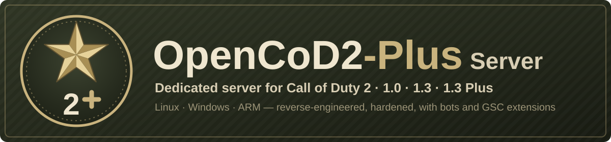

# OpenCoD2-Plus Server

<p align="center"></p>

[](https://github.com/JotaJazz/OpenCoD2-Plus-Server/actions/workflows/build.yml)
[](LICENSE)


[](https://github.com/voron00/CoD2rev_Server)
[](https://github.com/JotaJazz/OpenCoD2-Plus-Server/commits/dev)

[Español](README.es.md) · [English](README.md) · **Português** · [Français](README.fr.md) · [Deutsch](README.de.md) · [Русский](README.ru.md)

**O seu próprio servidor de Call of Duty 2, ainda hoje.** O OpenCoD2-Plus Server é o servidor dedicado multijogador de Call of Duty 2 reconstruído a partir do seu código-fonte, para as versões 1.0 e 1.3, em Windows e Linux. Os jogadores entram com o jogo que já têm; o servidor corrige muitos erros do original e acrescenta o que faltava aos administradores de servidores e aos modders. Um só processo do servidor pode receber jogadores 1.0 e 1.3 na mesma partida.

É um fork de [voron00/CoD2rev_Server](https://github.com/voron00/CoD2rev_Server), onde foi feita a engenharia reversa do servidor. Até novembro de 2026 chamava-se CoD2rev-Plus. É também o servidor do **CoD2 1.3 Plus**, um protocolo mais recente para o cliente [OpenCoD2-Plus](https://github.com/JotaJazz/OpenCoD2-Plus), que ainda está em desenvolvimento.

## O que faz hoje

- **Compilação para Windows e Linux:** compilação com MinGW para Windows, `make` para Linux de 64 bits, uma compilação para Linux de 32 bits, uma compilação experimental para ARM de 64 bits, como um Raspberry Pi, versão do jogo (1.0, 1.3 ou 1.3 Plus) escolhida ao compilar, compilações automáticas em cada push, lançadores, uma unidade do systemd e um `server.cfg` de exemplo.
- **Um servidor para 1.0 e 1.3:** a compilação 1.0 joga com clientes 1.0, 1.3, da Game Pass e CoD2x, e `net_altPort` mostra a mesma partida nas listas de servidores das duas versões.
- **Segurança e estabilidade:** a entrada de rede que derrubava o servidor ou sobrescrevia a sua memória é agora validada; as avalanches de consultas, ligações e comandos de clientes têm limite de frequência; o rcon bloqueia IPs após palavras-passe erradas; os downloads já não entregam os ficheiros originais do jogo; os banimentos são verificados em cada ligação; e uma falha deixa um relatório em `crash.log`.
- **Compatibilidade:** cerca de 20% menos tráfego para os clientes, mensagens grandes de clientes 1.3, servidores master como `host:porta`, `dedicated 1`, ficheiros do jogo em unidades do Windows no WSL, um relógio de jogo estável em longos períodos de funcionamento e bots que voltam após uma mudança de mapa.
- **Administração:** palavras-passe fora do log, nome, rotação e carimbos de tempo do log, rate e snapshots forçados, servidor de autorização de CD key configurável, mensagens de kick e timeout opcionais, opções para o ambiente dos mapas e um encerramento limpo com SIGTERM.
- **Scripting (libcod):** a maioria das funções e callbacks de script do [zk_libcod](https://github.com/ibuddieat/zk_libcod), com os mesmos nomes: erros de script com ficheiro e linha, botões premidos, comandos rcon, controlo de jogadores e armas, ferramentas de administração, grafos de waypoints com A\*, o que cada jogador vê, ouve e com o que colide, física, JSON, SQLite, clientes HTTP e WebSocket, sons pelo chat de voz e mais, corrigindo vários dos seus erros pelo caminho.
- **Mod de bots:** `mods/bots`, bots que se orientam por grafos de waypoints, usam a mira, granadas e faca, e jogam os objetivos de SD, CTF e HQ.
- **CoD2 1.3 Plus (em desenvolvimento):** `make PLUS=1` compila um servidor só para o cliente Plus, com um handshake que avisa os outros clientes para atualizarem e snapshots mais pequenos, a caminho dos 40–60 Hz. Todas as outras compilações mantêm o formato de rede original.
- **Testes:** um smoke test com um cliente mínimo que lê os snapshots do servidor, um teste de bots que joga mapas reais, e um teste de HTTP e WebSocket.

Também executa as partidas locais do [OpenCoD2-Plus](https://github.com/JotaJazz/OpenCoD2-Plus), um cliente de CoD2 reconstruído. Cada alteração em detalhe, com as suas funções, variáveis e correções, está em [docs/CHANGES.md](docs/CHANGES.md) (em inglês).

> [!NOTE]
> **Ainda em melhoria.** Se algo falhar ou se comportar de forma diferente do servidor original, comunique-o nas [issues](https://github.com/JotaJazz/OpenCoD2-Plus-Server/issues).

> [!IMPORTANT]
> **Não inclui ficheiros do jogo.** Este repositório contém apenas código-fonte. O servidor precisa da pasta `main` com os ficheiros `.iwd` de uma cópia de Call of Duty 2 que **seja sua**.

## Como executar

As compilações prontas a usar estão na página [**Releases**](https://github.com/JotaJazz/OpenCoD2-Plus-Server/releases), a partir da versão candidata `v1.0.0-rc1`; também pode compilar o servidor (ver [Compilar](#compilar)). Copie-o para a pasta do Call of Duty 2, junto a `main`, com um `server.cfg` em `main` ([`scripts/server.cfg.example`](scripts/server.cfg.example) é um bom ponto de partida).

**Windows:** copie `cod2rev_win32.exe` e [`scripts/windows/iniciar_cod2rev.bat`](scripts/windows/iniciar_cod2rev.bat) e execute:

```bat
iniciar_cod2rev.bat            :: LAN ou IP direto
iniciar_cod2rev.bat internet   :: também na lista pública de servidores
```

**Linux:** copie `cod2rev_lnxded` e [`scripts/linux/iniciar_cod2rev.sh`](scripts/linux/iniciar_cod2rev.sh) e execute:

```sh
./iniciar_cod2rev.sh            # LAN ou IP direto
./iniciar_cod2rev.sh internet   # também na lista pública de servidores
```

Ambos iniciam na porta `28960` com o mapa `mp_toujane`. Se o jogo também correr no mesmo PC, inicie primeiro o servidor: o jogo também usa a `28960`. Mais opções, a verificação de CD keys e o systemd estão em [Executar](#executar). Num Raspberry Pi 3, 4 ou 5 com um sistema de 64 bits, compile-o lá mesmo com `make ARCH=arm64`.

## Versões do jogo

| Compilação | Quem pode entrar | Lista de servidores |
| --- | --- | --- |
| `make` (1.0, a predefinição) | Clientes 1.0, 1.3, da Game Pass e CoD2x (protocolos 115 a 119) | 1.0; com `net_altPort` também 1.3 e CoD2x |
| `make PROTOCOL=118` (1.3) | Clientes 1.3 e CoD2x (protocolo 118) | 1.3 e CoD2x |
| `make PLUS=1` (1.3 Plus) | Só o cliente OpenCoD2-Plus; qualquer outro cliente recebe o aviso para atualizar | 1.3, para que os jogadores da versão original vejam o aviso em vez de nada |

- **Uma partida para 1.0 e 1.3:** inicie a compilação 1.0 com `+set net_altPort 28961` e ela responde numa segunda porta como 1.3, com os seus próprios heartbeats, pelo que a mesma partida aparece nas listas das duas versões. Clientes reais 1.0 e 1.3 já jogaram juntos uma partida desta forma. Execute-a com os ficheiros do jogo 1.0, sem `iw_15.iwd`, cujos scripts e menus os clientes 1.0 não têm.
- **CoD2x:** os clientes [CoD2x](https://github.com/callofduty2x/CoD2x) 1.4 ligam-se com o protocolo 118, e a sua lista de servidores só mostra os que informam o protocolo 118 ou 120, pelo que veem a compilação 1.3 e a `net_altPort` da compilação 1.0. Um cliente CoD2x já jogou em ambas.
- **O CoD2 1.3 Plus** destina-se a um cliente que ainda não pode ser distribuído, pelo que um servidor Plus público tem de esperar por ele. O seu protocolo está em [docs/architecture/plus-protocol.md](docs/architecture/plus-protocol.md).

## Para colaboradores

Toda a ajuda conta: ter um servidor a correr e comunicar o que corre mal, testar noutros sistemas, mods que usem as novas funções de script, ou código. O trabalho é feito no ramo `dev`, que chega ao `master` em cada versão publicada. A documentação técnica, em inglês, começa em [docs/README.md](docs/README.md); [AGENTS.md](AGENTS.md) é o ponto de entrada para agentes de programação de IA.

## Compilar

O resultado fica em `bin/` e os objetos intermédios em `obj/`.

### Linux

Por omissão, o servidor é um binário de 64 bits e só precisa de `gcc` e `g++`:

```bash
make                 # 1.0 -> bin/cod2rev_lnxded
make PROTOCOL=118    # 1.3, mesmo nome
make PLUS=1          # 1.3 Plus, mesmo nome
make ARCH=x86        # 32 bits, mesmo nome
make ARCH=arm64      # ARM de 64 bits (experimental), compilado na própria máquina ARM
```

A compilação de 32 bits num sistema de 64 bits precisa do suporte de 32 bits do GCC (em Debian e Ubuntu, os pacotes `gcc-multilib` e `g++-multilib`).

### Windows (cruzado a partir do Linux com MinGW)

Precisa do compilador MinGW-w64 de 32 bits com threads POSIX (em Debian e Ubuntu, `gcc-mingw-w64-i686-posix` e `g++-mingw-w64-i686-posix`):

```bash
make windows                 # 1.0 -> bin/cod2rev_win32.exe
make windows PROTOCOL=118    # 1.3, mesmo nome
```

### Windows (no próprio Windows, com MSYS2)

Instale o [MSYS2](https://www.msys2.org/) e, no seu terminal, o compilador MinGW-w64 de 32 bits: `pacman -S mingw-w64-i686-gcc mingw-w64-i686-make`. Depois compile a partir do `cmd`, não do terminal do MSYS2, com apenas esse compilador e o Windows no `PATH`:

```bat
set PATH=%SystemDrive%\msys64\mingw32\bin;%SystemRoot%\system32;%SystemRoot%
mingw32-make                 :: 1.0 -> bin\cod2rev_win32.exe
mingw32-make PROTOCOL=118    :: 1.3, mesmo nome
```

<details>
<summary><b>Versão do jogo, compilações automáticas e opções do Makefile</b></summary>

Sem `PROTOCOL`, ou com `PROTOCOL=115`, o servidor é compilado como 1.0. `PLUS=1` é uma compilação 1.3 e pode combinar-se com `ARCH` e `windows`. Cada plataforma e versão guarda os seus próprios objetos em `obj/`, pelo que pode mudar de uma para a outra sem `make clean`; todas as versões escrevem o mesmo nome de ficheiro, e `BIN_DIR=<folder>` compila para outra pasta para manter várias.

Cada push para `master` ou `dev` que altere o código compila 1.0 e 1.3 para Linux (32 e 64 bits) e Windows, e 1.3 Plus para Linux de 64 bits, no GitHub Actions ([`.github/workflows/build.yml`](.github/workflows/build.yml)). Os binários resultantes podem ser descarregados como artefactos no separador [Actions](https://github.com/JotaJazz/OpenCoD2-Plus-Server/actions) do repositório.

| Opção | Predefinição | Descrição |
| --- | --- | --- |
| `PROTOCOL` | `115` | `115` compila 1.0, `118` compila 1.3. |
| `PLUS` | `0` | `1` compila o CoD2 1.3 Plus, só para o cliente Plus. |
| `ARCH` | `x64` | `x86` para Linux de 32 bits, `arm64` para ARM de 64 bits. Windows é sempre de 32 bits. |
| `WITH_LIBCOD` | `true` | Inclui as extensões de script do libcod (bots, jogadores, entidades, armas, utilitários, etc.). |
| `WITH_SQLITE` | `true` | Funções de script para SQLite. |
| `WITH_MYSQL` | `false` | Funções de script para MySQL. Requer a biblioteca cliente do MySQL ou do MariaDB. |
| `WITH_SPEEX` | `true` | `loadSoundFile`, `playSoundFile` e as demais funções de som, com Speex (`src/libcod/speex`). |
| `WITH_HTTP` | `true` | `httpFetch` e `webSocket*`, com Mbed TLS (`src/libcod/mbedtls`) para `https://` e `wss://`. |

`make clean` apaga o binário e os objetos.

</details>

## Executar

<details>
<summary><b>Lançadores, autorização de CD key e systemd</b></summary>

Os lançadores iniciam por predefinição em modo LAN (`dedicated 1`: LAN ou IP direto); com `internet` anunciam o servidor na lista pública (`dedicated 2`). Definem os seus valores antes de `+exec server.cfg`, por isso o `server.cfg` pode alterá-los. Se o jogo já estiver a correr no mesmo PC, um servidor iniciado depois passa para a porta livre seguinte; `net_strictPort 1` faz com que pare em vez disso.

**Autorização de chaves:** o servidor consulta `cod2master.activision.com` para validar a chave de cada cliente que não esteja na rede local. Com `sv_cracked 1` continua a fazer a consulta, mas aceita o cliente seja qual for a resposta. Os lançadores só o ativam em modo LAN; em modo internet é exigida uma chave válida, a menos que o `server.cfg` o ative.

**systemd:** `scripts/linux/cod2rev@.service` executa servidores com o systemd, um por instância: `systemctl enable --now cod2rev@public` executa o `public.cfg` com a sua própria pasta em `/var/lib/cod2rev/public`, reinicia o servidor se ele falhar e para-o de forma limpa com SIGTERM (mensagem final, heartbeat flatline e logs fechados). Os comentários do ficheiro explicam como instalá-lo.

`run_bin.sh` é o script de testes do projeto original: inicia `bin/cod2rev_lnxded` em modo de desenvolvimento com cheats ativados e bots de teste. Serve de exemplo de parâmetros, não de configuração para um servidor real.

</details>

## Testes

<details>
<summary><b>Os scripts de teste</b></summary>

`scripts/smoke_test.py` precisa de um servidor compilado e de uma pasta do jogo:

```bash
python3 scripts/smoke_test.py /caminho/para/CoD2
make PROTOCOL=118 && python3 scripts/smoke_test.py /caminho/para/CoD2 --protocol 118
make PLUS=1 && python3 scripts/smoke_test.py /caminho/para/CoD2 --plus
```

Inicia o servidor em modo LAN com uma pasta de utilizador temporária, pelo que a pasta do jogo só é lida. Verifica que o servidor carrega um mapa e responde a `getinfo`, `getstatus` e rcon, e que `scripts/cod2client.py`, um cliente mínimo, consegue ligar-se, receber o gamestate, entrar na partida, ler snapshots e enviar comandos, também numa mensagem dividida em fragmentos; também tenta os ataques que o servidor tem de recusar. Use uma pasta do jogo com os `.iwd` originais: mods em `main` que substituem os scripts dos modos de jogo podem impedir que o mapa carregue.

`scripts/bots_test.py` instala o mod de bots numa pasta temporária, joga um mapa com seis bots e verifica que o grafo de waypoints é gerado, guardado e lido de novo, que os bots seguem rotas e usam a mira, as granadas e a faca, e que não há erros de script:

```bash
python3 scripts/bots_test.py /caminho/para/CoD2 --map mp_carentan
```

Com `--gametype sd`, `--gametype ctf` ou `--gametype hq` verifica antes que os bots jogam o objetivo. `--bombmode 1` joga SD no modo de uma só zona de bomba. `--corrupt-cache` parte de um ficheiro de waypoints danificado, que os bots devem substituir por um grafo novo.

`scripts/http_test.py` verifica `httpFetch` e `webSocket*` contra servidores locais HTTP, HTTPS, WS e WSS, e `scripts/check_docs.py` verifica as ligações e os caminhos da documentação.

Para procurar erros de memória, compile o servidor com AddressSanitizer numa pasta à parte e passe esse binário com `--binary`:

```bash
make OBJ_ROOT=/tmp/asan/obj BIN_DIR=/tmp/asan/bin \
  CFLAGS="-fno-pie -O1 -g -fno-omit-frame-pointer -msse2 -mfpmath=sse -DNDEBUG -DPROTOCOL_VERSION=115 -MMD -MP -m64 -D_FILE_OFFSET_BITS=64 -fsanitize=address" \
  LFLAGS="-no-pie -m64 -fsanitize=address"
```

`CFLAGS` na linha de comandos substitui o do Makefile, pelo que é preciso repetir `-m64` e `-D_FILE_OFFSET_BITS=64`. Deixar essa compilação a correr algum tempo com o mod de bots e um `sv_mapRotation` curto cobre também as mudanças de mapa e a partida.

</details>

## Estrutura do repositório

<details>
<summary><b>O que está onde</b></summary>

| Caminho | Conteúdo |
| --- | --- |
| `src/server` | Lógica do servidor: clientes, rede, rcon, master servers. |
| `src/game`, `src/bgame` | Lógica de jogo. |
| `src/script` | Máquina virtual de scripts GSC. |
| `src/qcommon`, `src/universal` | Código comum: comandos, variáveis (dvars), sistema de ficheiros, rede, o formato Plus. |
| `src/xanim` | Modelos e animações. |
| `src/stringed` | Textos localizados. |
| `src/libcod` | Extensões de script do libcod, com as bibliotecas que usam: SQLite, yyjson, Speex, Mbed TLS e os cabeçalhos do MySQL. |
| `src/win32`, `src/unix` | Código específico de cada plataforma. |
| `src/zlib` | Cópia do zlib. |
| `docs` | Documentação técnica para colaboradores e agentes de IA (índice em [docs/README.md](docs/README.md)), a lista de alterações e o protocolo do CoD2 1.3 Plus. |
| `scripts` | Lançadores para Windows e Linux, a unidade do systemd, o `server.cfg` de exemplo e o seu gerador, o instalador dos bots, o teste de fumo com o seu cliente mínimo, o teste dos bots, o teste de HTTP e WebSocket, e o verificador da documentação. |
| `mods/bots` | O mod de scripts dos bots. |

</details>

## Transparência

- **Quem mantém isto:** sou o JotaJazz. Gosto de jogos antigos e este fork existe por isso: quero continuar a poder ter um servidor de CoD2 nas minhas próprias máquinas.
- **Como se trabalha aqui:** trabalho com o [Claude Code](https://claude.com/claude-code), o assistente de programação da Anthropic. As alterações deste fork, incluindo este README e as suas traduções, são escritas com a sua ajuda. Os commits feitos assim têm a linha `Co-Authored-By: Claude` na mensagem, pelo que podem ser identificados no histórico com `git log`.
- **Relação com o original:** este fork traz alterações do repositório original quando existem, mas não lhe envia as suas. É provável que com o tempo se afaste dele.
- **O que não é:** não é um projeto oficial nem está associado à Activision, à Infinity Ward ou ao autor do repositório original. Não inclui nenhum ficheiro do jogo.

## Aviso

Esta é uma reconstrução independente, ao nível do código-fonte, do servidor dedicado de Call of Duty 2. Não está associada, autorizada, patrocinada nem aprovada pela Activision Publishing, Inc., pela Infinity Ward ou por qualquer das suas afiliadas.

"Call of Duty" e "Call of Duty 2" são marcas comerciais da Activision Publishing, Inc. São usadas neste repositório apenas para identificação e interoperabilidade, para descrever o que o código reconstrói. Não se reivindica nenhum direito sobre essas marcas.

Este projeto não fornece nem ajuda a obter dados do jogo protegidos por direitos de autor. Para o usar com conteúdo real do jogo, tem de fornecer os ficheiros de dados de uma cópia de Call of Duty 2 que possua legalmente.

Se for titular de direitos e considerar que algo aqui não deveria ser distribuído, abra uma issue ou contacte o responsável e o assunto será tratado com brevidade.

## Licença

[GNU Affero General Public License v3.0](LICENSE), a mesma do projeto original. As bibliotecas incluídas mantêm as suas próprias licenças: SQLite (domínio público), Mbed TLS (Apache-2.0, `src/libcod/mbedtls/LICENSE`), yyjson (MIT), Speex (BSD, `src/libcod/speex/COPYING`) e zlib (licença zlib).

## Créditos

- [voron00](https://github.com/voron00/CoD2rev_Server), autor do projeto original
- id Software
- Activision / Infinity Ward
- [CoD4x Server](https://github.com/callofduty4x/CoD4x_Server)
- [OpenBO2](https://github.com/builtbyxeno/OpenBO2)
- [zk_libcod](https://github.com/ibuddieat/zk_libcod) (ibuddieat), onde foram encontradas várias das correções deste fork
