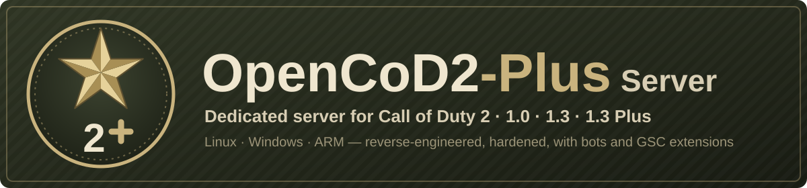

# CoD2rev-Plus

<p align="center"></p>

[](https://github.com/JotaJazz/CoD2rev-Plus/actions/workflows/build.yml)
[](LICENSE)


[](https://github.com/voron00/CoD2rev_Server)
[](https://github.com/JotaJazz/CoD2rev-Plus/commits/dev)

[Español](README.es.md) · [English](README.md) · [Português](README.pt.md) · [Français](README.fr.md) · [Deutsch](README.de.md) · **Русский**

**Свой сервер Call of Duty 2 — по-прежнему.** CoD2rev-Plus — это выделенный сервер сетевой игры Call of Duty 2, воссозданный на уровне исходного кода, для версий 1.0 и 1.3, в Windows и Linux. Игроки подключаются к нему с той игрой, что у них уже есть; он исправляет многие ошибки оригинального сервера и добавляет то, чего не хватало администраторам серверов и авторам модов. Один процесс сервера может принимать игроков 1.0 и 1.3 в одном матче.

Это форк [voron00/CoD2rev_Server](https://github.com/voron00/CoD2rev_Server), где и была проделана обратная разработка сервера. Это также сервер **CoD2 1.3 Plus** — нового протокола для клиента [OpenCoD2-Plus](https://github.com/JotaJazz/OpenCoD2-Plus), который ещё в разработке.

## Что он умеет сейчас

- **Сборки для Windows и Linux:** сборка MinGW для Windows, `make` для 64-битного Linux, сборка для 32-битного Linux, экспериментальная сборка для 64-битного ARM, например Raspberry Pi, версия игры (1.0, 1.3 или 1.3 Plus) выбирается при сборке, автоматические сборки при каждом push, скрипты запуска, юнит systemd и пример `server.cfg`.
- **Один сервер для 1.0 и 1.3:** сборка 1.0 играет с клиентами 1.0, 1.3, Game Pass и CoD2x, а `net_altPort` показывает один и тот же матч в списках серверов обеих версий.
- **Безопасность и стабильность:** сетевой ввод, который ронял сервер или перезаписывал его память, теперь проверяется; потоки запросов, подключений и клиентских команд ограничиваются по частоте; rcon блокирует IP после неверных паролей; загрузки больше не отдают оригинальные файлы игры; баны проверяются при каждом подключении; а при падении остаётся отчёт в `crash.log`.
- **Совместимость:** примерно на 20% меньше трафика к клиентам, большие сообщения от клиентов 1.3, мастер-серверы в виде `host:port`, `dedicated 1`, файлы игры на дисках Windows под WSL, ровные игровые часы при долгой непрерывной работе и боты, которые возвращаются после смены карты.
- **Администрирование:** пароли не попадают в лог, имя, ротация и отметки времени лога, принудительные rate и частота снапшотов, настраиваемый сервер авторизации CD-ключей, отключаемые сообщения о кике и таймауте, переключатели атмосферы карт (звуки, огонь, дым, погода, туман) и корректная остановка по SIGTERM.
- **Скрипты (libcod):** большинство функций и колбэков скриптов из [zk_libcod](https://github.com/ibuddieat/zk_libcod) с теми же именами: ошибки скриптов с файлом и строкой, нажатия кнопок, rcon-команды, управление игроками и оружием, инструменты администрирования, графы путевых точек с A\*, то, что каждый игрок видит, слышит и с чем сталкивается, физика, JSON, SQLite, клиенты HTTP и WebSocket, звуки через голосовой чат и многое другое, с исправлением ряда их ошибок.
- **Мод ботов:** `mods/bots`, боты, которые ориентируются по графам путевых точек, используют прицел, гранаты и нож и играют цели SD, CTF и HQ.
- **CoD2 1.3 Plus (в разработке):** `make PLUS=1` собирает сервер только для клиента Plus, с рукопожатием, которое сообщает другим клиентам о необходимости обновиться, и снапшотами меньшего размера — на пути к 40–60 Гц. Все остальные сборки сохраняют оригинальный сетевой формат.
- **Тесты:** smoke-тест с минимальным клиентом, который читает снапшоты сервера, тест ботов на настоящих картах и тест HTTP и WebSocket.

Он также запускает локальные игры [OpenCoD2-Plus](https://github.com/JotaJazz/OpenCoD2-Plus), воссозданного клиента CoD2. Каждое изменение подробно, с функциями, переменными и исправлениями, описано в [docs/CHANGES.md](docs/CHANGES.md) (на английском).

> [!NOTE]
> **Работа над ним продолжается.** Если что-то ломается или ведёт себя не так, как оригинальный сервер, сообщите об этом в [issues](https://github.com/JotaJazz/CoD2rev-Plus/issues).

> [!IMPORTANT]
> **Файлы игры не включены.** Этот репозиторий содержит только исходный код. Серверу нужна папка `main` с файлами `.iwd` из копии Call of Duty 2, **которая есть у вас**.

## Как запустить

Готовые к запуску сборки находятся на странице [**Releases**](https://github.com/JotaJazz/CoD2rev-Plus/releases), начиная с кандидата в релизы `v1.0.0-rc1`; сервер можно собрать и самостоятельно (см. [Сборка](#сборка)). Скопируйте его в папку Call of Duty 2, рядом с `main`, а в `main` положите `server.cfg` ([`scripts/server.cfg.example`](scripts/server.cfg.example) — хорошая отправная точка).

**Windows:** скопируйте `cod2rev_win32.exe` и [`scripts/windows/iniciar_cod2rev.bat`](scripts/windows/iniciar_cod2rev.bat), затем запустите:

```bat
iniciar_cod2rev.bat            :: локальная сеть или прямой IP
iniciar_cod2rev.bat internet   :: также в публичном списке серверов
```

**Linux:** скопируйте `cod2rev_lnxded` и [`scripts/linux/iniciar_cod2rev.sh`](scripts/linux/iniciar_cod2rev.sh), затем запустите:

```sh
./iniciar_cod2rev.sh            # локальная сеть или прямой IP
./iniciar_cod2rev.sh internet   # также в публичном списке серверов
```

Оба скрипта запускают сервер на порту `28960` с картой `mp_toujane`. Если игра тоже запущена на этом компьютере, сначала запустите сервер: игра тоже использует `28960`. Другие параметры, проверка CD-ключей и systemd описаны в разделе [Запуск](#запуск). На Raspberry Pi 3, 4 или 5 с 64-битной системой соберите его прямо там с помощью `make ARCH=arm64`.

## Версии игры

| Сборка | Кто может подключиться | Список серверов |
| --- | --- | --- |
| `make` (1.0, по умолчанию) | Клиенты 1.0, 1.3, Game Pass и CoD2x (протоколы от 115 до 119) | 1.0; с `net_altPort` также 1.3 и CoD2x |
| `make PROTOCOL=118` (1.3) | Клиенты 1.3 и CoD2x (протокол 118) | 1.3 и CoD2x |
| `make PLUS=1` (1.3 Plus) | Только клиент OpenCoD2-Plus; любому другому клиенту предлагается обновиться | 1.3, чтобы игроки с оригинальной игрой видели уведомление, а не пустоту |

- **Один матч для 1.0 и 1.3:** запустите сборку 1.0 с `+set net_altPort 28961`, и она будет отвечать на втором порту как 1.3, со своими heartbeat, так что один и тот же матч появится в списках обеих версий. Настоящие клиенты 1.0 и 1.3 уже играли так вместе в одном матче. Запускайте её на файлах игры 1.0, без `iw_15.iwd`, скриптов и меню которого нет у клиентов 1.0.
- **CoD2x:** клиенты [CoD2x](https://github.com/callofduty2x/CoD2x) 1.4 подключаются по протоколу 118, а их список серверов показывает только серверы, сообщающие протокол 118 или 120, поэтому они видят сборку 1.3 и `net_altPort` сборки 1.0. Клиентом CoD2x играли на обеих.
- **CoD2 1.3 Plus** предназначен для клиента, который пока нельзя распространять, поэтому публичному серверу Plus придётся его подождать. Его протокол описан в [docs/architecture/plus-protocol.md](docs/architecture/plus-protocol.md).

## Для участников

Пригодится любая помощь: запустить сервер и сообщить, что идёт не так, проверить на других системах, написать моды с новыми скриптовыми функциями или код. Работа ведётся в ветке `dev`, которая попадает в `master` с каждым релизом. Техническая документация, на английском, начинается с [docs/README.md](docs/README.md); [AGENTS.md](AGENTS.md) — точка входа для ИИ-агентов, которые пишут код.

## Сборка

Результат помещается в `bin/`, промежуточные объектные файлы — в `obj/`.

### Linux

По умолчанию сервер — это 64-битный бинарный файл, и ему нужны только `gcc` и `g++`:

```bash
make                 # 1.0 -> bin/cod2rev_lnxded
make PROTOCOL=118    # 1.3, то же имя
make PLUS=1          # 1.3 Plus, то же имя
make ARCH=x86        # 32 бита, то же имя
make ARCH=arm64      # 64-битный ARM (экспериментально), собирается на машине ARM
```

Сборке на 32 бита в 64-битной системе нужна поддержка 32 бит в GCC (в Debian и Ubuntu это пакеты `gcc-multilib` и `g++-multilib`). Сборка для ARM округляет математику не так, как оригинальный сервер, поэтому она пока не предназначена для соревновательной игры.

### Windows (кросс-компиляция из Linux с помощью MinGW)

Нужен 32-битный компилятор MinGW-w64 с потоками POSIX (в Debian и Ubuntu это пакеты `gcc-mingw-w64-i686-posix` и `g++-mingw-w64-i686-posix`):

```bash
make windows                 # 1.0 -> bin/cod2rev_win32.exe
make windows PROTOCOL=118    # 1.3, то же имя
```

<details>
<summary><b>Версия игры, автоматические сборки и параметры Makefile</b></summary>

Без `PROTOCOL` или с `PROTOCOL=115` сервер собирается как 1.0. `PLUS=1` — это сборка 1.3, и её можно сочетать с `ARCH` и `windows`. У каждой платформы и версии свои объектные файлы в `obj/`, поэтому переключаться между ними можно без `make clean`; все версии записывают файл с одним и тем же именем, а `BIN_DIR=<папка>` собирает в другую папку, чтобы сохранить несколько.

При каждом push в `master` или `dev`, который меняет код, в GitHub Actions собираются 1.0 и 1.3 для Linux (32 и 64 бита) и Windows, а также 1.3 Plus для 64-битного Linux ([`.github/workflows/build.yml`](.github/workflows/build.yml)). Готовые бинарные файлы можно скачать как артефакты на вкладке [Actions](https://github.com/JotaJazz/CoD2rev-Plus/actions) репозитория.

| Параметр | По умолчанию | Описание |
| --- | --- | --- |
| `PROTOCOL` | `115` | `115` собирает 1.0, `118` собирает 1.3. |
| `PLUS` | `0` | `1` собирает CoD2 1.3 Plus, только для клиента Plus. |
| `ARCH` | `x64` | `x86` для 32-битного Linux, `arm64` для 64-битного ARM. Windows всегда 32-битный. |
| `WITH_LIBCOD` | `true` | Включает скриптовые расширения libcod (боты, игроки, сущности, оружие, утилиты и т. д.). |
| `WITH_SQLITE` | `true` | Скриптовые функции для SQLite. |
| `WITH_MYSQL` | `false` | Скриптовые функции для MySQL. Требуется клиентская библиотека MySQL или MariaDB. |
| `WITH_SPEEX` | `true` | `loadSoundFile`, `playSoundFile` и остальные звуковые функции, на Speex (`src/libcod/speex`). |
| `WITH_HTTP` | `true` | `httpFetch` и `webSocket*`, на Mbed TLS (`src/libcod/mbedtls`) для `https://` и `wss://`. |

`make clean` удаляет бинарный файл и объектные файлы.

</details>

## Запуск

<details>
<summary><b>Скрипты запуска, проверка CD-ключей и systemd</b></summary>

По умолчанию скрипты запуска работают в режиме локальной сети (`dedicated 1`: локальная сеть или прямой IP); с `internet` они объявляют сервер в публичном списке (`dedicated 2`). Они задают свои значения до `+exec server.cfg`, поэтому `server.cfg` может их изменить. Если игра уже запущена на этом компьютере, сервер, запущенный после неё, переходит на следующий свободный порт; с `net_strictPort 1` он вместо этого останавливается.

**Проверка ключей:** сервер обращается к `cod2master.activision.com`, чтобы проверить ключ каждого клиента, который находится не в локальной сети. С `sv_cracked 1` запрос по-прежнему отправляется, но клиент принимается при любом ответе. Скрипты запуска включают эту переменную только в режиме локальной сети; в режиме интернета требуется действительный ключ, если `server.cfg` её не включает.

**systemd:** `scripts/linux/cod2rev@.service` запускает серверы через systemd, по одному на экземпляр: `systemctl enable --now cod2rev@public` запускает `public.cfg` с собственной папкой в `/var/lib/cod2rev/public`, перезапускает сервер после падения и корректно останавливает его по SIGTERM (последнее сообщение, flatline-heartbeat, закрытые логи). Как его установить, объясняют комментарии в файле.

`run_bin.sh` — тестовый скрипт оригинального проекта: он запускает `bin/cod2rev_lnxded` в режиме разработчика с включёнными читами и тестовыми ботами. Он годится как пример параметров, но не как конфигурация настоящего сервера.

</details>

## Тесты

<details>
<summary><b>Тестовые скрипты</b></summary>

Для `scripts/smoke_test.py` нужны собранный сервер и папка игры:

```bash
python3 scripts/smoke_test.py /путь/к/CoD2
make PROTOCOL=118 && python3 scripts/smoke_test.py /путь/к/CoD2 --protocol 118
make PLUS=1 && python3 scripts/smoke_test.py /путь/к/CoD2 --plus
```

Он запускает сервер в режиме LAN с временной домашней папкой, поэтому папка игры только читается. Он проверяет, что сервер загружает карту и отвечает на `getinfo`, `getstatus` и rcon, а `scripts/cod2client.py`, минимальный клиент, может подключиться, получить gamestate, войти в игру, читать снапшоты и отправлять команды, в том числе в сообщении, разбитом на фрагменты; он также пробует атаки, которые сервер должен отклонить. Используйте папку игры с оригинальными файлами `.iwd`: моды в `main`, заменяющие скрипты режимов игры, могут не дать карте загрузиться.

`scripts/bots_test.py` устанавливает мод ботов во временную папку, играет карту с шестью ботами и проверяет, что граф путевых точек строится, сохраняется и читается снова, что боты следуют маршрутам и используют прицел, гранаты и нож и что нет ошибок скриптов:

```bash
python3 scripts/bots_test.py /путь/к/CoD2 --map mp_carentan
```

С `--gametype sd`, `--gametype ctf` или `--gametype hq` он вместо этого проверяет, что боты играют цель режима. `--bombmode 1` играет SD в режиме с одной зоной закладки бомбы. `--corrupt-cache` начинает с повреждённого файла путевых точек, который боты должны заменить новым графом.

`scripts/http_test.py` проверяет `httpFetch` и `webSocket*` на локальных серверах HTTP, HTTPS, WS и WSS, а `scripts/check_docs.py` проверяет ссылки и пути в документации.

Чтобы искать ошибки памяти, соберите сервер с AddressSanitizer в отдельной папке и передайте этот бинарный файл через `--binary`:

```bash
make OBJ_ROOT=/tmp/asan/obj BIN_DIR=/tmp/asan/bin \
  CFLAGS="-fno-pie -O1 -g -fno-omit-frame-pointer -mfpmath=387 -DNDEBUG -DPROTOCOL_VERSION=115 -MMD -MP -m64 -D_FILE_OFFSET_BITS=64 -fsanitize=address" \
  LFLAGS="-no-pie -m64 -fsanitize=address"
```

`CFLAGS`, заданный в командной строке, заменяет значение из Makefile, поэтому `-m64` и `-D_FILE_OFFSET_BITS=64` нужно указать снова. Если оставить такую сборку поработать какое-то время с модом ботов и коротким `sv_mapRotation`, будут проверены и смены карт, и сама игра.

</details>

## Структура репозитория

<details>
<summary><b>Что где находится</b></summary>

| Путь | Содержимое |
| --- | --- |
| `src/server` | Логика сервера: клиенты, сеть, rcon, мастер-серверы. |
| `src/game`, `src/bgame` | Игровая логика. |
| `src/script` | Виртуальная машина скриптов GSC. |
| `src/qcommon`, `src/universal` | Общий код: команды, переменные (dvars), файловая система, сеть, формат Plus. |
| `src/xanim` | Модели и анимации. |
| `src/stringed` | Локализованные строки. |
| `src/libcod` | Скриптовые расширения libcod с библиотеками, которые они используют: SQLite, yyjson, Speex, Mbed TLS и заголовки MySQL. |
| `src/win32`, `src/unix` | Код, зависящий от платформы. |
| `src/zlib` | Копия zlib. |
| `docs` | Техническая документация для участников и ИИ-агентов (оглавление в [docs/README.md](docs/README.md)), список изменений и протокол CoD2 1.3 Plus. |
| `scripts` | Скрипты запуска для Windows и Linux, юнит systemd, пример `server.cfg` и его генератор, установщик ботов, проверочный тест с минимальным клиентом, тест ботов, тест HTTP и WebSocket, а также проверка документации. |
| `mods/bots` | Скриптовый мод ботов. |

</details>

## Прозрачность

- **Кто это поддерживает:** я JotaJazz. Мне нравятся старые игры, и именно поэтому существует этот форк: я хочу и дальше иметь возможность запускать сервер CoD2 на своих машинах.
- **Как здесь ведётся работа:** я работаю с [Claude Code](https://claude.com/claude-code), помощником по программированию от Anthropic. Изменения этого форка, включая этот README и его переводы, написаны с его помощью. Сделанные так коммиты содержат в сообщении строку `Co-Authored-By: Claude`, поэтому их можно найти в истории через `git log`.
- **Отношения с оригиналом:** этот форк забирает изменения из оригинального репозитория, когда они появляются, но свои туда не отправляет. Со временем он, вероятно, будет всё сильнее от него отличаться.
- **Чем это не является:** это не официальный проект, и он не связан с Activision, Infinity Ward или автором оригинального репозитория. В нём нет файлов игры.

## Уведомление

Это независимая реконструкция выделенного сервера Call of Duty 2 на уровне исходного кода. Она не связана с Activision Publishing, Inc., Infinity Ward или их аффилированными лицами, не авторизована, не спонсируется и не одобрена ими.

«Call of Duty» и «Call of Duty 2» — товарные знаки Activision Publishing, Inc. В этом репозитории они используются только для идентификации и совместимости, чтобы описать, что воссоздаёт код. Никаких прав на эти знаки не заявляется.

Этот проект не предоставляет защищённые авторским правом данные игры и не помогает их получить. Чтобы использовать его с настоящим игровым контентом, нужны файлы данных из копии Call of Duty 2, которой вы законно владеете.

Если вы правообладатель и считаете, что что-то здесь не должно распространяться, откройте issue или свяжитесь с сопровождающим, и вопрос будет быстро решён.

## Лицензия

[GNU Affero General Public License v3.0](LICENSE), та же, что и у оригинального проекта. Встроенные библиотеки сохраняют свои лицензии: SQLite (общественное достояние), Mbed TLS (Apache-2.0, `src/libcod/mbedtls/LICENSE`), yyjson (MIT), Speex (BSD, `src/libcod/speex/COPYING`) и zlib (лицензия zlib).

## Благодарности

- [voron00](https://github.com/voron00/CoD2rev_Server), автор оригинального проекта
- id Software
- Activision / Infinity Ward
- [CoD4x Server](https://github.com/callofduty4x/CoD4x_Server)
- [OpenBO2](https://github.com/builtbyxeno/OpenBO2)
- [zk_libcod](https://github.com/ibuddieat/zk_libcod) (ibuddieat), где были найдены несколько исправлений этого форка
